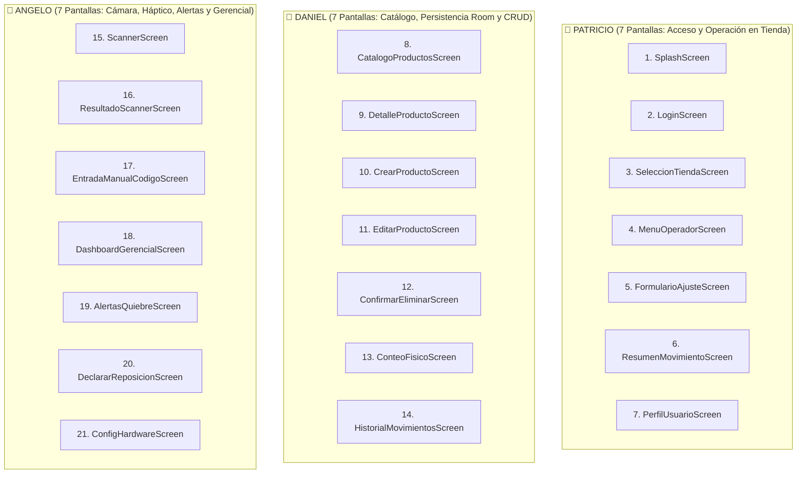

# 📱 Guía Práctica de Desarrollo - App Inventario Multi-Tienda (BexAI)

> **Asignatura:** DSY1105 - Desarrollo de Aplicaciones Móviles (Duoc UC)  
> **Objetivo de la Fase 1:** Prototipo funcional simple y ejecutable (Material 3 estándar, sin sobrecarga de diseño ni animaciones complejas).  
> **Evaluaciones:** Parcial 2 (Encargo - 8%) y Parcial 3 (Defensa Técnica Individual - 32%).  
> **Meta del Docente:** Al menos 21 pantallas funcionales (7 pantallas por cada integrante).

---

## 🎯 1. Principios de Esta Primera Entrega

1. **Funcionalidad sobre Diseño:** No perder tiempo en paletas de colores complejas, sombras o animaciones rebuscadas. Usar componentes estándar de Jetpack Compose (`Button`, `Card`, `OutlinedTextField`, `Text`, `LazyColumn`).
2. **Animación Mínima Exigida:** Solo se incluye un loader circular en el botón al guardar (`CircularProgressIndicator`) y transición básica de pantalla para cumplir con el indicador de la rúbrica (**IE 2.2.2**).
3. **Cumplimiento de los 2 Recursos Nativos (Obligatorio en Rúbrica IE 2.4.1):**
   * **Recurso 1:** Cámara con CameraX + Google ML Kit (Lector de códigos de barra).
   * **Recurso 2:** Motor Háptico / Vibración del celular (`Vibrator`) al leer un código o confirmar un ajuste.
4. **Trabajo 100% Independiente:** Cada integrante programa en su propia carpeta y rama Git sin depender de que los demás terminen.

---

## 👥 2. Distribución Equitativa de Pantallas (21 Pantallas / 7 por Integrante)

Cada integrante desarrolla **7 pantallas funcionales completas**, abarcando vistas, componentes y lógica:



---

### 📋 Detalle de las 21 Pantallas por Integrante

#### 👤 Patricio (7 Pantallas - Módulo Acceso y Operación)
* **Rama Git:** `feature/ui-navegacion`  
* **Carpeta de trabajo:** `ui/screens/operador/` y `ui/components/`

| # | Composable | Ruta Nav | Descripción Funcional Simple |
| :-: | :--- | :--- | :--- |
| **1** | `SplashScreen` | `"splash"` | Logo/Texto de la app, retardo de 2 seg y navega a Login. |
| **2** | `LoginScreen` | `"login"` | Campos de usuario, clave y radio-buttons para rol (Operador, Bodega, Gerente). |
| **3** | `SeleccionTiendaScreen` | `"tiendas"` | Lista de sucursales simples (*"Centro"*, *"Pudahuel"*, *"Providencia"*). |
| **4** | `MenuOperadorScreen` | `"menu_operador"` | 3 botones grandes: "Escanear Código", "Ajuste Manual", "Ver Catálogo". |
| **5** | `FormularioAjusteScreen`| `"ajuste/{codigo}"` | Recibe código escaneado, campo para cantidad y selector Entrada/Salida. |
| **6** | `ResumenMovimientoScreen`| `"resumen_ajuste"` | Muestra comprobante con datos del ajuste guardado con éxito. |
| **7** | `PerfilUsuarioScreen` | `"perfil"` | Muestra nombre del operario, sucursal activa y botón Cerrar Sesión. |

#### 👤 Daniel (7 Pantallas - Módulo Catálogo, Room y Bodega)
* **Rama Git:** `feature/data-viewmodel`  
* **Carpeta de trabajo:** `data/repository/`, `modelo/`, `viewmodel/` y `ui/screens/inventario/`

| # | Composable | Ruta Nav | Descripción Funcional Simple |
| :-: | :--- | :--- | :--- |
| **8** | `CatalogoProductosScreen` | `"catalogo"` | `LazyColumn` observando Room (`Flow`) con campo de búsqueda por nombre. |
| **9** | `DetalleProductoScreen` | `"producto/{id}"` | Muestra código de barras, nombre, precio, stock actual y stock mínimo. |
| **10** | `CrearProductoScreen` | `"producto_nuevo"` | Formulario para ingresar nuevo producto con validación de campos obligatorios. |
| **11** | `EditarProductoScreen` | `"producto_editar/{id}"`| Modifica precio, categoría o stock mínimo de un producto existente. |
| **12** | `ConfirmarEliminarScreen` | `"producto_eliminar/{id}"`| Vista simple de confirmación antes de borrar el producto de Room. |
| **13** | `ConteoFisicoScreen` | `"conteo_fisico"` | Lista para que el bodeguero anote el conteo real contado en pasillo. |
| **14** | `HistorialMovimientosScreen`| `"historial"` | Lista de ajustes registrados con tipo (Entrada/Salida) y timestamp. |

#### 👤 Angelo (7 Pantallas - Módulo Hardware, Alertas y Gerencial)
* **Rama Git:** `feature/camara-dashboard`  
* **Carpeta de trabajo:** `util/`, `ui/screens/scanner/` y `ui/screens/gerencial/`

| # | Composable | Ruta Nav | Descripción Funcional Simple |
| :-: | :--- | :--- | :--- |
| **15** | `ScannerScreen` | `"scanner"` | Cámara abierta con CameraX + ML Kit y botón para encender linterna. |
| **16** | `ResultadoScannerScreen`| `"scan_result/{codigo}"`| Muestra código leído, dispara vibración háptica y botón "Ajustar Stock". |
| **17** | `EntradaManualCodigoScreen`| `"scanner_manual"` | Fallback si la cámara no enfoca: teclado numérico para escribir código. |
| **18** | `DashboardGerencialScreen`| `"dashboard"` | 3 tarjetas simples de métricas: Total SKUs, Unidades Totales y Quiebres. |
| **19** | `AlertasQuiebreScreen` | `"alertas"` | Lista de productos críticos donde `stockActual <= stockMinimo` en color rojo. |
| **20** | `DeclararReposicionScreen`| `"reposicion/{id}"` | Formulario para pedir stock de un producto en quiebre. |
| **21** | `ConfigHardwareScreen` | `"config_hardware"` | Botón "Probar Vibración Háptica" y estado de permiso de cámara. |

---

## 💻 3. Paso a Paso para Trabajar en PC sin Errores

### 3.1 Abrir el Proyecto por Primera Vez
1. Abrir Android Studio y verificar que el Gradle JDK sea Java 17 o 21:  
   `Settings` -> `Build, Execution, Deployment` -> `Build Tools` -> `Gradle` -> **`Gradle JDK = jbr-17 o jbr-21`**.
2. Presionar el ícono de elefante (**Sync Project with Gradle Files**).  
   *(Las dependencias de Navigation, CameraX y ML Kit ya están agregadas y probadas en el proyecto).*

### 3.2 Trabajar en su Propia Rama (Terminal de Android Studio `Alt + F12`)
* **Patricio:**
  ```bash
  git checkout -b feature/ui-navegacion
  ```
* **Daniel:**
  ```bash
  git checkout -b feature/data-viewmodel
  ```
* **Angelo:**
  ```bash
  git checkout -b feature/camara-dashboard
  ```

---

## 🧩 4. Código Base Necesario por Integrante

### 4.1 Daniel: Ajuste de Entidad, DAO y Repositorio

#### Entidad `Producto.kt` (`modelo/Producto.kt`)
```kotlin
package com.example.multitienda.modelo

import androidx.room3.Entity
import androidx.room3.PrimaryKey

@Entity(tableName = "productos")
data class Producto(
    @PrimaryKey(autoGenerate = true) val id: Int = 0,
    val codigoBarras: String,
    val nombre: String,
    val categoria: String = "General",
    val precio: Double = 0.0,
    val stockActual: Int,
    val stockMinimo: Int = 5
)
```

#### Repositorio `ProductoRepository.kt` (`data/repository/ProductoRepository.kt`)
```kotlin
package com.example.multitienda.data.repository

import com.example.multitienda.modelo.Producto
import com.example.multitienda.modelo.ProductoDAO
import kotlinx.coroutines.flow.Flow

class ProductoRepository(private val dao: ProductoDAO) {
    val productos: Flow<List<Producto>> = dao.listarProductos()

    suspend fun insertar(producto: Producto) = dao.agregarProducto(producto)
    suspend fun actualizar(producto: Producto) = dao.actualizarProducto(producto)
    suspend fun eliminar(producto: Producto) = dao.eliminarProducto(producto)
}
```

---

### 4.2 Angelo: Servicio Háptico y Pantalla de Escáner

#### Helper de Vibración `HapticFeedbackHelper.kt` (`util/HapticFeedbackHelper.kt`)
```kotlin
package com.example.multitienda.util

import android.content.Context
import android.os.Build
import android.os.VibrationEffect
import android.os.Vibrator
import android.os.VibratorManager

object HapticFeedbackHelper {
    fun vibrar(context: Context, duracionMs: Long = 100) {
        if (Build.VERSION.SDK_INT >= Build.VERSION_CODES.S) {
            val vm = context.getSystemService(Context.VIBRATOR_MANAGER_SERVICE) as VibratorManager
            vm.defaultVibrator.vibrate(VibrationEffect.createOneShot(duracionMs, VibrationEffect.DEFAULT_AMPLITUDE))
        } else {
            @Suppress("DEPRECATION")
            val v = context.getSystemService(Context.VIBRATOR_SERVICE) as Vibrator
            v.vibrate(duracionMs)
        }
    }
}
```

---

### 4.3 Patricio: Componente de Texto Validado

#### `CustomTextField.kt` (`ui/components/CustomTextField.kt`)
```kotlin
package com.example.multitienda.ui.components

import androidx.compose.foundation.layout.Column
import androidx.compose.foundation.layout.fillMaxWidth
import androidx.compose.foundation.layout.padding
import androidx.compose.material3.MaterialTheme
import androidx.compose.material3.OutlinedTextField
import androidx.compose.material3.Text
import androidx.compose.runtime.Composable
import androidx.compose.ui.Modifier
import androidx.compose.ui.unit.dp

@Composable
fun CustomTextField(
    value: String,
    onValueChange: (String) -> Unit,
    label: String,
    isError: Boolean = false,
    errorMessage: String? = null
) {
    Column(modifier = Modifier.fillMaxWidth().padding(vertical = 4.dp)) {
        OutlinedTextField(
            value = value,
            onValueChange = onValueChange,
            label = { Text(label) },
            isError = isError,
            singleLine = true,
            modifier = Modifier.fillMaxWidth()
        )
        if (isError && !errorMessage.isNullOrBlank()) {
            Text(
                text = errorMessage,
                color = MaterialTheme.colorScheme.error,
                style = MaterialTheme.typography.bodySmall,
                modifier = Modifier.padding(start = 8.dp, top = 2.dp)
            )
        }
    }
}
```

---

## 🔌 5. Integración: Punto de Entrada `MainActivity.kt`

Para que al pulsar **Play** se abra la navegación global con las pantallas:

```kotlin
package com.example.multitienda

import android.os.Bundle
import androidx.activity.ComponentActivity
import androidx.activity.compose.setContent
import androidx.activity.enableEdgeToEdge
import com.example.multitienda.ui.navigation.AppNavigation
import com.example.multitienda.ui.theme.MultiTiendaTheme

class MainActivity : ComponentActivity() {
    override fun onCreate(savedInstanceState: Bundle?) {
        super.onCreate(savedInstanceState)
        enableEdgeToEdge()
        setContent {
            MultiTiendaTheme {
                AppNavigation()
            }
        }
    }
}
```

---

## 📷 6. Cómo Probar Cámara y Vibración (Emulador vs Teléfono)

1. **En el Emulador de Android Studio:**
   * Ir a `Device Manager` -> Clic en el lápiz del emulador (`Edit`).
   * Desplegar `Show Advanced Settings`.
   * En `Camera` -> `Back Camera` seleccionar **`Webcam0`**. Con esto, el emulador usará la cámara web de tu PC para escanear cualquier código de barras real.
   * La vibración en emulador no se siente físicamente, pero se confirma mediante un mensaje en Logcat o un `Toast` en pantalla.
2. **En Teléfono Físico (Recomendado para la Defensa):**
   * Activar `Opciones de desarrollador` y `Depuración por USB` en el celular.
   * Conectar con cable USB, seleccionar el teléfono en Android Studio y presionar **Play**. La cámara escaneará al instante y el celular vibrará físicamente al leer un código.

---

## 🛡️ 7. Guía Rápida para la Defensa Individual (Parcial 3 - 32%)

En la semana 11/12, el profesor llamará a cada integrante 15 minutos y pedirá modificar algo en tiempo real:

| Pregunta / Solicitud del Profesor | Dónde ir y qué hacer |
| :--- | :--- |
| **"Agrega una nueva validación al formulario"** | Abrir `FormularioViewModel.kt` y agregar una condición `if (campo.isEmpty()) error = "Obligatorio"`. |
| **"Modifica o crea una consulta en Room"** | Abrir `ProductoDAO.kt` y escribir `@Query("SELECT * FROM productos WHERE precio > :min") fun filtrar(...): Flow<List<Producto>>`. |
| **"¿Por qué usamos Repository?"** | Responder: *"Para desacoplar la base de datos Room del ViewModel, permitiendo cambiar la fuente de datos (ej. agregar API REST) sin romper la UI"*. |
| **"¿Cuáles son los 2 recursos nativos?"** | Responder: *"1) Cámara física con CameraX y Google ML Kit, y 2) Motor háptico de vibración del hardware con `Vibrator` para confirmar lecturas en bodega"*. |
