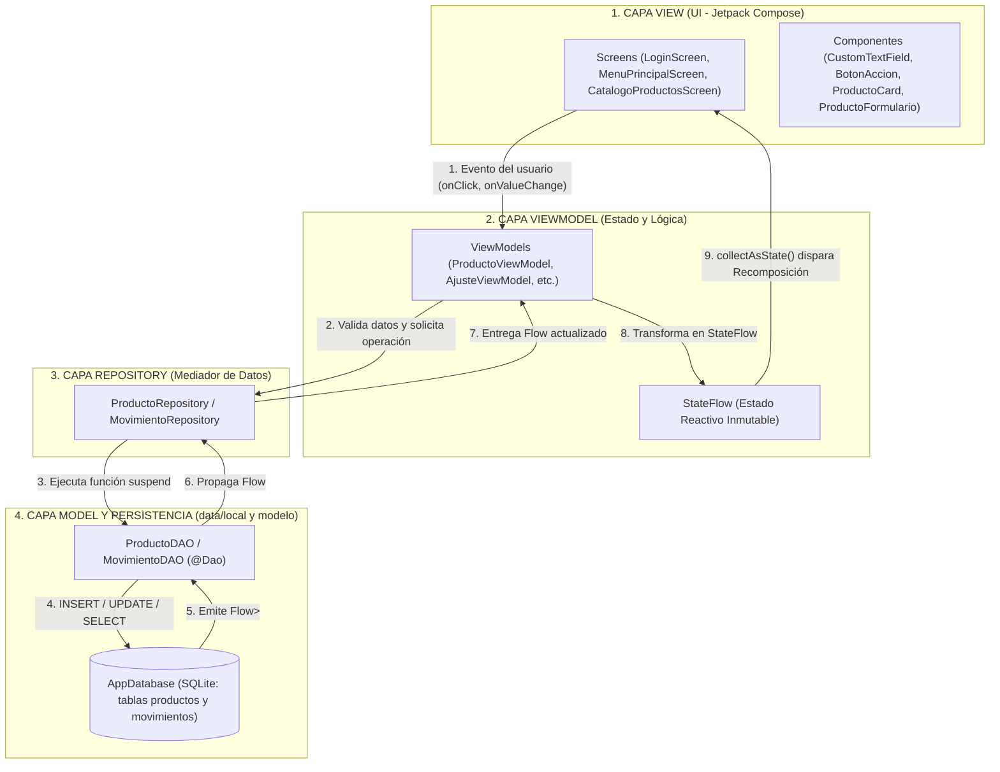

# Guía Maestra de Estudio, Presentación y Defensa Técnica
**Proyecto:** App Mobile de Inventario Multi-Tienda con Escaneo de Códigos (Caso BexAI)  
**Asignatura:** Desarrollo de Aplicaciones Móviles (`DSY1105`) — Duoc UC  
**Integrantes del Equipo:**
1. **Patricio Céspedes** — Flujo de Autenticación, Perfiles, Operaciones de Terreno y Navegación Principal
2. **Daniel Aedo** — Persistencia Local con Room, Catálogo CRUD, Conteo Físico, Diferencias e Historial
3. **Angelo Valenzuela** — Recursos Nativos (CameraX + ML Kit + Motor Háptico), Tablero Gerencial, Alertas y Reportes

---

## Capítulo 1: Análisis General del Proyecto

### 1.1 ¿Qué aplicación estamos desarrollando y cuál es su propósito?
Estamos desarrollando **MultiTienda (BexAI Inventory)**, una aplicación móvil nativa para **Android** diseñada para digitalizar el levantamiento, control y auditoría de stock en una red comercial compuesta por múltiples tiendas y bodegas (como *Bodega Pudahuel*, *Sucursal Santiago Centro*, *Tienda Providencia*, *Bodega Logística Sur*).

* **Problemática que resuelve:** En el caso de negocio BexAI, las tiendas llevaban su inventario en planillas Excel aisladas y hojas de papel. Esto causaba errores de digitación al escribir códigos de barra a mano, diferencias inexplicables en los conteos físicos, falta de trazabilidad sobre quién modificó el stock y demoras en detectar quiebres de stock.
* **Solución implementada:** Un MVP (Producto Mínimo Viable) funcional con **tres perfiles de usuario diferenciados** (*Operador*, *Encargado de Bodega* y *Gerencial*), lectura de códigos de barra con la cámara del teléfono en tiempo real, retroalimentación háptica (vibración), validación lógica desacoplada y persistencia de datos local con base de datos SQLite mediante **Room**.

---

### 1.2 Configuración Técnica y Versiones Reales del Proyecto
Toda la configuración de versiones se centraliza en el catálogo de versiones [`libs.versions.toml`](file:///c:/Users/patri/AndroidStudioProjects/MultiTienda/gradle/libs.versions.toml) y en [`build.gradle.kts`](file:///c:/Users/patri/AndroidStudioProjects/MultiTienda/app/build.gradle.kts):

| Parámetro / Herramienta | Valor en el Proyecto | ¿Qué significa técnicamente? |
| :--- | :--- | :--- |
| **Namespace / Application ID** | `com.example.multitienda` | Identificador único del paquete de la aplicación en Android. |
| **Lenguaje** | **Kotlin `2.2.10`** | Lenguaje oficial moderno para Android, conciso, seguro frente a nulos (*Null Safety*) y con soporte nativo de Corrutinas. |
| **Android Gradle Plugin (AGP)** | `9.5.0` | Motor de compilación oficial que empaqueta el código Kotlin y recursos en un archivo `.apk`. |
| **KSP (Kotlin Symbol Processing)** | `2.3.6` | Procesador de anotaciones ultrarrápido que lee las etiquetas `@Entity`, `@Dao` y `@Database` de Room y genera el código SQL automáticamente al compilar. |
| **`minSdk`** | `24` (Android 7.0 Nougat) | Versión mínima de Android en la que puede instalarse la app (cubre más del 97% de dispositivos activos). |
| **`targetSdk` / `compileSdk`** | `37` | Versión del SDK de Android con la que se compila y sobre la que se validan los permisos y comportamientos modernos. |
| **Compatibilidad JVM** | `JavaVersion.VERSION_11` | Estándar de bytecode Java utilizado por el compilador. |
| **Compose BOM** | `2026.02.01` | *Bill of Materials*: asegura que todas las librerías de Jetpack Compose usen versiones compatibles entre sí sin conflictos. |

---

### 1.3 Dependencias Declaradas y para qué sirve cada una

En [`build.gradle.kts`](file:///c:/Users/patri/AndroidStudioProjects/MultiTienda/app/build.gradle.kts) se declaran las siguientes librerías:

1. **Interfaz de Usuario (Jetpack Compose y Material 3):**
   * `androidx.compose.ui`, `ui-graphics`, `ui-tooling-preview`: Motor de dibujo declarativo de pantallas.
   * `androidx.compose.material3`: Componentes visuales modernos de Google (botones, tarjetas `ElevatedCard`, `Scaffold`, `TopAppBar`, `FilterChip`).
   * `androidx.compose.material:material-icons-extended`: Íconos vectoriales de Material Design (escáner QR, tienda, advertencias, historial, etc.).
   * `androidx.activity:activity-compose (1.13.0)`: Permite conectar la `MainActivity` con el árbol de funciones `@Composable` mediante `setContent { ... }`.

2. **Arquitectura MVVM y Ciclo de Vida:**
   * `androidx.lifecycle:lifecycle-runtime-ktx (2.11.0)`: Provee ámbitos de corrutinas ligados al ciclo de vida de la app.
   * `androidx.lifecycle:lifecycle-viewmodel-compose (2.11.0)`: Permite instanciar y observar `ViewModel` directamente dentro de funciones `@Composable` usando `viewModel()`.

3. **Navegación:**
   * `androidx.navigation:navigation-compose (2.8.4)`: Gestiona el cambio entre las 23 pantallas de la aplicación (`NavHost`, `NavController`, paso de argumentos tipados en rutas y control del historial de retroceso o *backstack*).

4. **Persistencia de Datos Local (Room 3):**
   * `androidx.room3:room3-runtime (3.0.3)` y `room3-common (3.0.3)`: Librería de abstracción sobre SQLite para guardar productos y movimientos de forma permanente en el teléfono.
   * `ksp(libs.androidx.room3.compiler)`: Compilador en tiempo de compilación que traduce nuestras interfaces DAO en consultas SQL reales.

5. **Recursos Nativos (Cámara e Inteligencia Artificial):**
   * `androidx.camera:camera-core`, `camera-camera2`, `camera-lifecycle`, `camera-view (1.4.0)`: **CameraX**, librería de Jetpack que controla el hardware de la cámara trasera y el flash/linterna adaptándose automáticamente al ciclo de vida de la pantalla.
   * `com.google.mlkit:barcode-scanning (17.3.0)`: **Google ML Kit**, motor de visión artificial que analiza cada fotograma de la cámara para detectar códigos de barras (`EAN-13`, `EAN-8`, `CODE-128`, `UPC-A`, `QR`).

---

### 1.4 Permisos de Hardware en `AndroidManifest.xml`
En [`AndroidManifest.xml`](file:///c:/Users/patri/AndroidStudioProjects/MultiTienda/app/src/main/AndroidManifest.xml) declaramos el acceso a los **dos recursos nativos exigidos por la rúbrica (Indicador IE 2.4.1)**:
```xml
<!-- RECURSO NATIVO 1: CÁMARA Y LINTERNA -->
<uses-feature android:name="android.hardware.camera" android:required="false" />
<uses-feature android:name="android.hardware.camera.flash" android:required="false" />
<uses-permission android:name="android.permission.CAMERA" />

<!-- RECURSO NATIVO 2: VIBRACIÓN Y RESPUESTA HÁPTICA -->
<uses-permission android:name="android.permission.VIBRATE" />
```
> [!TIP]
> **Dato clave para el profesor:** Se puso `android:required="false"` en `<uses-feature>` para que la aplicación también pueda instalarse y ejecutarse en emuladores o tablets que no tengan flash físico, ofreciendo además una pantalla de **Entrada Manual de Código** como respaldo.

---

### 1.5 Cómo Levantar el Proyecto en Android Studio Rabbit 2 y Rabbit 1 (PCs del Duoc)

* **En Android Studio Rabbit 2 (Configuración por defecto):**
  * Abrir el proyecto, ejecutar **Sync Project with Gradle Files** (`Ctrl + Shift + O`) y presionar **Run 'app'** (`Shift + F10`).
* **En PCs de Laboratorio Duoc UC (Android Studio Rabbit 1):**
  * Como el proyecto tiene configurado `agp = "9.5.0"` (de Rabbit 2), al abrirlo en Rabbit 1 aparecerá el aviso:  
    `The project is using an incompatible version (AGP 9.5.0) of the Android Gradle plugin. Latest supported version is AGP X.X.X`
  * **Paso 1 (`gradle/libs.versions.toml`):** Abrir [`libs.versions.toml`](file:///c:/Users/patri/AndroidStudioProjects/MultiTienda/gradle/libs.versions.toml#L2) y en la **línea 2** cambiar `agp = "9.5.0"` por la versión exacta que indique el mensaje de Rabbit 1 (ej. `agp = "9.4.0"` o `"9.1.0"`).
  * **Paso 2 (`gradle-wrapper.properties`):** Si Rabbit 1 pide bajar la versión de `gradle-9.6.0-bin.zip` en [`gradle-wrapper.properties`](file:///c:/Users/patri/AndroidStudioProjects/MultiTienda/gradle/wrapper/gradle-wrapper.properties#L4-L5), **borrar la línea 4 (`distributionSha256Sum=...`)** para que no falle la validación de hash SHA-256.
  * **Paso 3 (`app/build.gradle.kts` y SDK 37):**
    * Si al bajar el AGP se marca en rojo el bloque `optimization { ... }` en [`build.gradle.kts`](file:///c:/Users/patri/AndroidStudioProjects/MultiTienda/app/build.gradle.kts#L25-L28), reemplazarlo por `isMinifyEnabled = false`.
    * Si el PC del Duoc no tiene instalado el **SDK 37**, ir a **Tools ➔ SDK Manager**, marcar **Android API 37** y darle a **Apply** (no requiere permisos de administrador).

---

## Capítulo 2: Estructura de Carpetas y Archivos

El código fuente se ubica en `app/src/main/java/com/example/multitienda/` y sigue una estructura modular por capas y dominios:

```text
com.example.multitienda/
├── MainActivity.kt                        # Único punto de entrada (Single-Activity Architecture)
├── data/
│   ├── local/                             # CAPA DE PERSISTENCIA LOCAL (Room SQLite)
│   │   ├── AppDatabase.kt                 # @Database configuración Singleton de Room (versión 2)
│   │   ├── ProductoDAO.kt                 # @Dao consultas SQL para productos
│   │   └── MovimientoDAO.kt               # @Dao consultas SQL para movimientos
│   └── repository/                        # CAPA REPOSITORY: Mediador entre DAOs y ViewModels
│       ├── ProductoRepository.kt          # Lógica de acceso a productos + semilla inicial (6 productos)
│       ├── MovimientoRepository.kt        # Lógica de acceso al historial de movimientos
│       └── TiendaRepository.kt            # Estado persistente de tiendas habilitadas/suspendidas
├── modelo/                                # CAPA MODEL: Entidades Room y Modelos de Estado
│   ├── Producto.kt                        # @Entity tabla "productos"
│   ├── Movimiento.kt                      # @Entity tabla "movimientos"
│   └── ProductoFormModel.kt               # Modelo de estado y errores del formulario de producto
├── viewmodel/                             # CAPA VIEWMODEL: Lógica de negocio, validaciones y StateFlow
│   ├── LoginViewModel.kt                  # Autenticación, validación de credenciales y selección de perfil
│   ├── ProductoViewModel.kt               # CRUD de catálogo, búsqueda reactiva y conteo físico
│   ├── AjusteViewModel.kt                 # Cálculo de entradas, salidas, validación de stock y registro
│   ├── DashboardViewModel.kt              # Cálculo reactivo de KPIs gerenciales (SKUs, unidades, % quiebre)
│   ├── HistorialViewModel.kt              # Filtrado reactivo de transacciones de auditoría
│   └── ReposicionViewModel.kt             # Solicitud y abastecimiento por quiebre de stock
├── util/                                  # UTILIDADES NATIVAS
│   └── HapticFeedbackHelper.kt            # Controlador del motor de vibración física (API 24 a 37)
└── ui/                                    # CAPA VIEW (Interfaz de Usuario en Jetpack Compose)
    ├── components/                        # Componentes visuales reutilizables
    │   ├── BotonAccion.kt                 # Botón corporativo con animación de carga (AnimatedVisibility)
    │   ├── CustomTextField.kt             # Campo de texto validado con ícono de alerta y mensaje de error
    │   ├── ProductoCard.kt                # Tarjeta reutilizable de resumen de producto y alerta de bajo stock
    │   └── ProductoFormulario.kt          # Formulario reutilizable para crear y editar productos
    ├── navigation/                        # Enrutamiento central y grafos de navegación
    │   ├── AppRoutes.kt                   # Constantes de rutas y constructores de argumentos URI
    │   ├── AppNavigation.kt               # NavHost principal que conecta todas las pantallas
    │   └── InventarioNavigation.kt        # Subgrafo de rutas del módulo de inventario
    ├── theme/                             # Diseño visual Material 3
    │   ├── Color.kt                       # Paleta de colores corporativa
    │   ├── Theme.kt                       # Configuración de MultiTiendaTheme (claro/oscuro)
    │   └── Type.kt                        # Tipografías y tamaños de texto
    └── screens/                           # Pantallas organizadas por dominio funcional
        ├── auth/                          # Inicio y Autenticación (Transversal)
        │   ├── SplashScreen.kt
        │   └── LoginScreen.kt
        ├── home/                          # Menú Principal, Perfil y Sucursal (Compartido por los 3 roles)
        │   ├── MenuPrincipalScreen.kt
        │   ├── PerfilUsuarioScreen.kt
        │   └── SeleccionTiendaScreen.kt
        ├── operador/                      # Operaciones de Ajuste en Terreno
        │   ├── FormularioAjusteScreen.kt
        │   └── ResumenMovimientoScreen.kt
        ├── scanner/                       # Escaneo con Cámara y Respaldo Manual
        │   ├── ScannerScreen.kt
        │   ├── ResultadoScannerScreen.kt
        │   └── EntradaManualCodigoScreen.kt
        ├── inventario/                    # Catálogo, Conteo, Diferencias y Auditoría Room
        │   ├── CatalogoProductosScreen.kt
        │   ├── DetalleProductoScreen.kt
        │   ├── CrearProductoScreen.kt
        │   ├── EditarProductoScreen.kt
        │   ├── ConfirmarEliminarScreen.kt
        │   ├── ConteoFisicoScreen.kt
        │   ├── DiferenciasStockScreen.kt
        │   └── HistorialMovimientosScreen.kt
        └── gerencial/                     # Supervisión, Alertas, Tiendas y Reportes
            ├── DashboardGerencialScreen.kt
            ├── AlertasQuiebreScreen.kt
            ├── DeclararReposicionScreen.kt
            ├── AdminTiendasScreen.kt
            └── ExportarReportesScreen.kt
```

---

## Capítulo 3: Arquitectura del Proyecto — Patrón MVVM

### 3.1 ¿Qué es MVVM?
**MVVM** significa **Model – View – ViewModel** (Modelo – Vista – VistaModelo). Es el patrón arquitectónico oficial recomendado por Google para el desarrollo de aplicaciones Android modernas. Su propósito principal es **separar la interfaz gráfica (lo que el usuario ve) de la lógica de negocio y de los datos (cómo funciona el sistema por dentro)**.

### 3.2 Las Capas de nuestra Arquitectura



1. **Model y Capa de Datos (`modelo/`, `data/local/` y `data/repository/`):**
   * Representa los datos reales de la aplicación y las reglas de almacenamiento.
   * Incluye las entidades [`Producto.kt`](file:///c:/Users/patri/AndroidStudioProjects/MultiTienda/app/src/main/java/com/example/multitienda/modelo/Producto.kt) y [`Movimiento.kt`](file:///c:/Users/patri/AndroidStudioProjects/MultiTienda/app/src/main/java/com/example/multitienda/modelo/Movimiento.kt), los DAOs en `data/local/` y los Repositorios en `data/repository/`.
   * **Regla de oro:** El Modelo *no sabe que existe una pantalla ni botones*.

2. **View (`ui/screens/` y `ui/components/`):**
   * Es la interfaz visual escrita con funciones `@Composable`.
   * Su única responsabilidad es **mostrar el estado actual** en pantalla y **avisar al ViewModel** cuando el usuario toca un botón o escribe texto.
   * **Regla de oro:** La Vista *nunca hace cálculos matemáticos de stock ni consultas SQL directas*.

3. **ViewModel (`viewmodel/`):**
   * Es el "cerebro" intermediario entre la Vista y el Modelo.
   * Recibe las acciones del usuario desde la Vista, valida que los campos sean correctos, llama al Repositorio en segundo plano usando corrutinas (`viewModelScope.launch`) y expone el resultado en variables observables (`StateFlow`).
   * **Regla de oro:** El ViewModel *nunca tiene referencias a botones ni componentes de Compose*, lo que evita fugas de memoria (*memory leaks*) cuando se gira la pantalla.

---

### 3.3 Flujo Unidireccional de Datos (UDF): Ejemplo Real Paso a Paso
Veamos qué ocurre exactamente en el código cuando un Operador realiza un **Conteo Físico** en [`ConteoFisicoScreen.kt`](file:///c:/Users/patri/AndroidStudioProjects/MultiTienda/app/src/main/java/com/example/multitienda/ui/screens/inventario/ConteoFisicoScreen.kt):

1. **Acción del Usuario (Evento hacia abajo):** El usuario escribe `"20"` en el campo *"Conteo real en pasillo"* y presiona el botón `"Registrar Conteo"`.
2. **La Vista invoca al ViewModel:** La pantalla ejecuta:
   ```kotlin
   onRegistrar = { viewModel.registrarConteo(productoId, conteo, tienda, motivo) }
   ```
3. **El ViewModel valida la lógica:** En [`ProductoViewModel.kt`](file:///c:/Users/patri/AndroidStudioProjects/MultiTienda/app/src/main/java/com/example/multitienda/viewmodel/ProductoViewModel.kt#L213-L235), la función `registrarConteo` verifica si `nuevoStock` es un número entero mayor o igual a 0. Si el usuario escribió letras o un número negativo, actualiza `_conteoError.value = "Ingrese un conteo válido (0 o más)"` y detiene la operación.
4. **Corrutina y llamada al Repositorio:** Si el dato es válido, abre una corrutina con `viewModelScope.launch`, calcula la diferencia (`nuevoStock - producto.stock`), actualiza el stock en `productoRepository.actualizarStock(id, nuevoStock)` y guarda el registro de auditoría en `movimientoRepository.registrar(...)`.
5. **Room actualiza SQLite y notifica:** Room ejecuta el `UPDATE` en el archivo físico de base de datos y automáticamente emite la nueva lista por el `Flow<List<Producto>>`.
6. **Actualización de la Interfaz (Estado hacia arriba):** El ViewModel pone `_conteoGuardado.value = true`. La pantalla, que está observando esa variable mediante `val guardado by viewModel.conteoGuardado.collectAsState()`, detecta el cambio y regresa automáticamente a la pantalla anterior mostrando el nuevo stock actualizado.

---

## Capítulo 4: Componentes e Interfaz de Usuario (Jetpack Compose)

### 4.1 ¿Qué es Jetpack Compose?
**Jetpack Compose** es el kit de herramientas moderno de Android que usa **programación declarativa**: escribimos funciones en Kotlin anotadas con `@Composable` que describen *cómo debe verse la pantalla para un estado dado*. Cuando un dato cambia, Compose vuelve a ejecutar automáticamente solo las funciones que dependen de ese dato. A este proceso se le llama **Recomposición**.

### 4.2 Diferencia entre una Pantalla (*Screen*) y un Componente Reutilizable
* **Componente Reutilizable (`ui/components/`):** Es una pieza visual pequeña, genérica e independiente que se usa en muchas partes de la app (`BotonAccion`, `CustomTextField`, `ProductoCard`, `ProductoFormulario`). No tiene `ViewModel` propio; recibe todo por parámetros.
* **Pantalla o *Screen* (`ui/screens/`):** Es una vista completa que representa una ruta de navegación (`LoginScreen`, `MenuPrincipalScreen`, `CatalogoProductosScreen`). Combina varios componentes reutilizables y se conecta con un `ViewModel`.

---

### 4.3 Análisis de los Componentes Reutilizables de Nuestro Proyecto (`ui/components/`)

1. **[`CustomTextField.kt`](file:///c:/Users/patri/AndroidStudioProjects/MultiTienda/app/src/main/java/com/example/multitienda/ui/components/CustomTextField.kt) (Indicador IE 2.1.2):**
   * Envuelve un `OutlinedTextField` de Material 3. Si `isError` es `true`, pinta el borde en rojo, muestra un ícono de advertencia (`Icons.Default.Warning`) y despliega debajo el mensaje `errorMessage`.
   * Aplica **State Hoisting** (elevación de estado): recibe `value` y notifica cada tecla con `onValueChange`.
2. **[`BotonAccion.kt`](file:///c:/Users/patri/AndroidStudioProjects/MultiTienda/app/src/main/java/com/example/multitienda/ui/components/BotonAccion.kt) (Indicador IE 2.2.2):**
   * Integra `AnimatedVisibility` con `fadeIn()` y `fadeOut()`. Cuando `isLoading` es `true`, deshabilita el botón para evitar dobles clics, muestra un `CircularProgressIndicator` y cambia el texto a `"Procesando..."`.
3. **[`ProductoCard.kt`](file:///c:/Users/patri/AndroidStudioProjects/MultiTienda/app/src/main/java/com/example/multitienda/ui/components/ProductoCard.kt):**
   * Tarjeta reutilizable que muestra nombre, código EAN, categoría, precio, stock actual, stock mínimo y una etiqueta roja `"BAJO STOCK"` si `producto.stock <= producto.stockMinimo`.
4. **[`ProductoFormulario.kt`](file:///c:/Users/patri/AndroidStudioProjects/MultiTienda/app/src/main/java/com/example/multitienda/ui/components/ProductoFormulario.kt):**
   * Formulario compartido tanto por [`CrearProductoScreen.kt`](file:///c:/Users/patri/AndroidStudioProjects/MultiTienda/app/src/main/java/com/example/multitienda/ui/screens/inventario/CrearProductoScreen.kt) como por [`EditarProductoScreen.kt`](file:///c:/Users/patri/AndroidStudioProjects/MultiTienda/app/src/main/java/com/example/multitienda/ui/screens/inventario/EditarProductoScreen.kt), evitando duplicar los 6 campos de validación.

---

## Capítulo 5: ViewModel y Gestión de Estados

### 5.1 ¿Qué es un ViewModel y por qué sobrevive a cambios de configuración?
Cuando el usuario gira el teléfono de vertical a horizontal, Android destruye y vuelve a crear la `MainActivity`. Un **`ViewModel`** vive en un espacio de memoria separado que **no se destruye cuando la pantalla rota**, conservando intactos los datos y formularios.
* [`LoginViewModel.kt`](file:///c:/Users/patri/AndroidStudioProjects/MultiTienda/app/src/main/java/com/example/multitienda/viewmodel/LoginViewModel.kt) hereda de `ViewModel()`.
* [`ProductoViewModel.kt`](file:///c:/Users/patri/AndroidStudioProjects/MultiTienda/app/src/main/java/com/example/multitienda/viewmodel/ProductoViewModel.kt), [`AjusteViewModel.kt`](file:///c:/Users/patri/AndroidStudioProjects/MultiTienda/app/src/main/java/com/example/multitienda/viewmodel/AjusteViewModel.kt), [`DashboardViewModel.kt`](file:///c:/Users/patri/AndroidStudioProjects/MultiTienda/app/src/main/java/com/example/multitienda/viewmodel/DashboardViewModel.kt), [`HistorialViewModel.kt`](file:///c:/Users/patri/AndroidStudioProjects/MultiTienda/app/src/main/java/com/example/multitienda/viewmodel/HistorialViewModel.kt) y [`ReposicionViewModel.kt`](file:///c:/Users/patri/AndroidStudioProjects/MultiTienda/app/src/main/java/com/example/multitienda/viewmodel/ReposicionViewModel.kt) heredan de `AndroidViewModel(application)` porque necesitan el contexto global `Application` para abrir Room (`AppDatabase.getDatabase(application)`).

### 5.2 Diferencia entre Variable Común, `MutableStateFlow` y `StateFlow`

| Tipo de Variable | ¿Compose detecta cuando cambia? | ¿Dónde se usa? |
| :--- | :---: | :--- |
| `var contador = 0` (Variable común) | **NO.** La pantalla no se redibuja. | Cálculos internos temporales dentro de una función. |
| `_state = MutableStateFlow(...)` | **SÍ (Lectura y Escritura).** | Privado (`private`) dentro del `ViewModel`. |
| `state: StateFlow<...> = _state.asStateFlow()` | **SÍ (Solo Lectura).** | Público en el `ViewModel` para que la pantalla lo observe con `collectAsState()`. |

---

## Capítulo 6: Base de Datos Local con Room

### 6.1 ¿Qué es Room y qué relación tiene con SQLite?
Android incluye de fábrica un motor de base de datos relacional llamado **SQLite**. **Room** es la capa de abstracción (ORM — *Object-Relational Mapping*) oficial de Android Jetpack sobre SQLite. Transforma tablas SQL en clases de datos Kotlin (`data class`) y verifica en **tiempo de compilación** (gracias al plugin KSP) que todas nuestras consultas SQL estén bien escritas.

### 6.2 Los 3 Pilares de Room en `data/local/` y `modelo/`

1. **`@Entity` (Las Tablas en `modelo/`):**
   * **[`Producto.kt`](file:///c:/Users/patri/AndroidStudioProjects/MultiTienda/app/src/main/java/com/example/multitienda/modelo/Producto.kt):** Define la tabla `"productos"` con `@PrimaryKey(autoGenerate = true) val id: Int = 0`.
   * **[`Movimiento.kt`](file:///c:/Users/patri/AndroidStudioProjects/MultiTienda/app/src/main/java/com/example/multitienda/modelo/Movimiento.kt):** Define la tabla `"movimientos"`, vinculada por `codigoBarras: String` y con marca de tiempo `fechaMillis`.
2. **`@Dao` (Las Consultas SQL en `data/local/`):**
   * **[`ProductoDAO.kt`](file:///c:/Users/patri/AndroidStudioProjects/MultiTienda/app/src/main/java/com/example/multitienda/data/local/ProductoDAO.kt)** y **[`MovimientoDAO.kt`](file:///c:/Users/patri/AndroidStudioProjects/MultiTienda/app/src/main/java/com/example/multitienda/data/local/MovimientoDAO.kt)**.
   * Las operaciones de escritura llevan **`suspend`** (corren en corrutinas fuera del hilo principal) y las consultas de listado devuelven **`Flow<List<...>>`** (se actualizan en vivo).
3. **`@Database` (El Motor Central en `data/local/`):**
   * **[`AppDatabase.kt`](file:///c:/Users/patri/AndroidStudioProjects/MultiTienda/app/src/main/java/com/example/multitienda/data/local/AppDatabase.kt):** Configura la base de datos SQLite `"base_productos"` usando el patrón **Singleton** (`@Volatile` + `synchronized(this)`). Se almacena físicamente en `/data/data/com.example.multitienda/databases/base_productos`.

---

## Capítulo 7: Repositorios y Flujo de Datos

* **[`ProductoRepository.kt`](file:///c:/Users/patri/AndroidStudioProjects/MultiTienda/app/src/main/java/com/example/multitienda/data/repository/ProductoRepository.kt)** y **[`MovimientoRepository.kt`](file:///c:/Users/patri/AndroidStudioProjects/MultiTienda/app/src/main/java/com/example/multitienda/data/repository/MovimientoRepository.kt)** actúan como **única fuente de verdad (*Single Source of Truth*)** entre Room y los ViewModels.
* `sembrarSiVacio()` comprueba `if (dao.contarProductos() == 0)` e inserta automáticamente los 6 productos sintéticos de prueba la primera vez que se abre la app.

---

## Capítulo 8: Funcionamiento Integral de la Aplicación y Perfiles

Al iniciar sesión en [`LoginScreen.kt`](file:///c:/Users/patri/AndroidStudioProjects/MultiTienda/app/src/main/java/com/example/multitienda/ui/screens/auth/LoginScreen.kt), el sistema identifica el rol del usuario y adapta dinámicamente [`MenuPrincipalScreen.kt`](file:///c:/Users/patri/AndroidStudioProjects/MultiTienda/app/src/main/java/com/example/multitienda/ui/screens/home/MenuPrincipalScreen.kt):

| Perfil | Credencial de Prueba (Clave: `1234`) | Herramientas Habilitadas en `MenuPrincipalScreen` |
| :--- | :--- | :--- |
| **1. Operador de Terreno** | `test1@bexai.cl` o `operador@bexai.cl` | • Cambiar sucursal/bodega activa<br>• **Escanear Producto** (Cámara CameraX + ML Kit)<br>• **Registrar Movimiento** (Entrada, Salida, Ajuste)<br>• **Conteo Físico** en pasillo |
| **2. Encargado de Bodega** | `test2@bexai.cl` o `bodega@bexai.cl` | • Cambiar sucursal/bodega activa<br>• **Agregar Producto** nuevo al catálogo<br>• **Consultar Stock Disponible** (Catálogo completo y CRUD)<br>• **Control de Diferencias** (Auditoría sistema vs físico)<br>• **Alertas de Reposición** y declaración de pedidos |
| **3. Perfil Gerencial** | `test3@bexai.cl` o `gerente@bexai.cl` | • **Tablero Analítico (Dashboard)** con KPIs en tiempo real<br>• **Auditoría de Existencias Globales**<br>• **Alertas de Quiebre de Stock**<br>• **Historial de Modificaciones** (Trazabilidad completa)<br>• **Administración de Tiendas** habilitadas<br>• **Exportar Reportes** (Excel `.xlsx` / `.csv`) |

---

## Capítulo 9: Explicación de Código Importante (Línea por Línea)

### 9.1 [`AppDatabase.kt`](file:///c:/Users/patri/AndroidStudioProjects/MultiTienda/app/src/main/java/com/example/multitienda/data/local/AppDatabase.kt) — El Patrón Singleton de Base de Datos
```kotlin
@Database(entities = [Producto::class, Movimiento::class], version = 2, exportSchema = false)
abstract class AppDatabase : RoomDatabase() {
    abstract fun productoDAO(): ProductoDAO
    abstract fun movimientoDAO(): MovimientoDAO

    companion object {
        @Volatile
        private var INSTANCIA: AppDatabase? = null

        fun getDatabase(context: Context): AppDatabase {
            return INSTANCIA ?: synchronized(this) {
                val instancia = Room.databaseBuilder(
                    context,
                    AppDatabase::class.java,
                    "base_productos"
                ).fallbackToDestructiveMigration().build()
                INSTANCIA = instancia
                instancia
            }
        }
    }
}
```
* **¿Por qué se implementó con `@Volatile` y `synchronized(this)`?:** Abrir una conexión a SQLite es costoso en memoria. El patrón **Singleton** garantiza que en toda la app exista **una única instancia abierta** (`INSTANCIA`). `@Volatile` asegura visibilidad entre hilos y `synchronized(this)` evita que dos corrutinas creen dos bases de datos al mismo tiempo.
* **¿Qué hace `.fallbackToDestructiveMigration()`?:** Si subimos la versión de la base de datos (por ejemplo, de `version = 2` a `version = 3` al agregar una columna), Room recrea las tablas limpiamente sin que la app sufra un cierre forzoso (`IllegalStateException`).

---

### 9.2 [`ProductoViewModel.kt`](file:///c:/Users/patri/AndroidStudioProjects/MultiTienda/app/src/main/java/com/example/multitienda/viewmodel/ProductoViewModel.kt) — Búsqueda Reactiva con `combine` y `stateIn`
```kotlin
val productos: StateFlow<List<Producto>> =
    combine(productoRepository.productos, _busqueda) { lista, texto ->
        if (texto.isBlank()) lista
        else lista.filter { it.nombre.contains(texto, ignoreCase = true) }
    }.stateIn(
        viewModelScope,
        SharingStarted.WhileSubscribed(5000),
        emptyList()
    )
```
* **¿Cómo explicarlo oralmente?:**
  * `combine` une dos flujos de datos: la lista de productos que viene de Room (`productoRepository.productos`) y el texto que el usuario escribe en el buscador (`_busqueda`).
  * Cada vez que el usuario escribe una letra **o** se modifica un producto en Room, ese bloque se ejecuta automáticamente y filtra la lista ignorando mayúsculas/minúsculas (`ignoreCase = true`).
  * `SharingStarted.WhileSubscribed(5000)` mantiene vivo el flujo hasta 5 segundos después de que la pantalla desaparece (por ejemplo, mientras se gira el teléfono).

---

### 9.3 [`ScannerScreen.kt`](file:///c:/Users/patri/AndroidStudioProjects/MultiTienda/app/src/main/java/com/example/multitienda/ui/screens/scanner/ScannerScreen.kt) — Integración de CameraX y Google ML Kit
* **Permisos en tiempo de ejecución:** Usa `rememberLauncherForActivityResult(ActivityResultContracts.RequestPermission())` para pedir permiso `Manifest.permission.CAMERA` al usuario de forma segura.
* **Puente con vistas nativas (`AndroidView`):** Como `PreviewView` de CameraX es un componente tradicional de Android, se integra dentro de Jetpack Compose mediante `AndroidView(factory = { ... })`.
* **Análisis de fotogramas (`ImageAnalysis`):**
  * Usa `ImageAnalysis.STRATEGY_KEEP_ONLY_LATEST` para analizar solo el último fotograma disponible sin acumular cola ni ralentizar el teléfono.
  * Convierte el frame en un `InputImage` y se lo pasa a `BarcodeScanning.getClient(...)`.
  * Cuando detecta un código, marca `codigoYaProcesado = true`, dispara la vibración con `HapticFeedbackHelper.vibrarExito(context)`, cierra el `imageProxy.close()` y navega al resultado.

---

### 9.4 [`HapticFeedbackHelper.kt`](file:///c:/Users/patri/AndroidStudioProjects/MultiTienda/app/src/main/java/com/example/multitienda/util/HapticFeedbackHelper.kt) — Compatibilidad Multi-API de Vibración
* En Android 12 (API 31 / `Build.VERSION_CODES.S`), Google introdujo `VIBRATOR_MANAGER_SERVICE`.
* Nuestro helper comprueba `if (Build.VERSION.SDK_INT >= Build.VERSION_CODES.S)` para usar `VibratorManager` en teléfonos modernos y hace *fallback* automático a `Vibrator` en teléfonos con Android 7 a 11. Además envuelve todo en un `try-catch` para que nunca falle en un emulador sin motor vibrador físico.

---

## Capítulo 10: Banco de Preguntas Técnicas del Docente

### Nivel Básico
1. **¿Qué es Kotlin y por qué lo usamos en lugar de Java?**
   * *Respuesta:* Es el lenguaje oficial de Android; ofrece seguridad contra valores nulos (*Null Safety* con `?`), clases de datos (`data class`) y soporte nativo para Corrutinas y Jetpack Compose.
2. **¿Qué es una Activity y cuántas tiene nuestro proyecto?**
   * *Respuesta:* Nuestro proyecto sigue la arquitectura **Single-Activity**: solo tenemos [`MainActivity.kt`](file:///c:/Users/patri/AndroidStudioProjects/MultiTienda/app/src/main/java/com/example/multitienda/MainActivity.kt), y dentro de ella todas las 23 pantallas son funciones `@Composable` intercambiadas por `Navigation Compose`.
3. **¿Qué es un componente `@Composable`?**
   * *Respuesta:* Es una función en Kotlin anotada con `@Composable` que transforma estado en interfaz gráfica reactiva, como nuestro `BotonAccion` o `CustomTextField`.

### Nivel Intermedio
4. **¿Qué diferencia hay entre la Vista (Screen) y el ViewModel?**
   * *Respuesta:* La Vista (`Screen`) solo dibuja la interfaz y captura clics; el `ViewModel` valida las reglas de negocio, consulta al Repositorio y conserva el estado si se gira la pantalla.
5. **¿Cómo funciona la navegación entre pantallas y qué hace `popUpTo`?**
   * *Respuesta:* Usamos `NavHost` y `NavController` en [`AppNavigation.kt`](file:///c:/Users/patri/AndroidStudioProjects/MultiTienda/app/src/main/java/com/example/multitienda/ui/navigation/AppNavigation.kt). Con `popUpTo(AppRoutes.LOGIN) { inclusive = true }` al iniciar sesión (o `popUpTo(0)` al cerrar sesión) limpiamos la pila de historial (*Backstack*) para que el botón Atrás no regrese a una sesión cerrada.
6. **¿Cómo se pasan datos de una pantalla a otra en Navigation Compose?**
   * *Respuesta:* Se pasan como argumentos en la ruta definidos con `navArgument` en [`AppRoutes.kt`](file:///c:/Users/patri/AndroidStudioProjects/MultiTienda/app/src/main/java/com/example/multitienda/ui/navigation/AppRoutes.kt), usando `Uri.encode()` al enviar y `Uri.decode()` al recibir.

### Nivel Avanzado
7. **¿Por qué las funciones del DAO llevan la palabra `suspend`?**
   * *Respuesta:* Para que las operaciones de lectura y escritura en disco (SQLite) se ejecuten en segundo plano dentro de una corrutina (`viewModelScope.launch`) y nunca congelen el hilo principal de la pantalla.
8. **¿Qué pasa si un Operador intenta registrar una Salida de 50 unidades cuando solo hay 24 en stock?**
   * *Respuesta:* En [`AjusteViewModel.kt`](file:///c:/Users/patri/AndroidStudioProjects/MultiTienda/app/src/main/java/com/example/multitienda/viewmodel/AjusteViewModel.kt#L63-L70) se evalúa `if (cantidad > producto.stock)`, se aborta la operación antes de tocar Room y se emite `AjusteEstado(error = "Stock insuficiente: disponible ${producto.stock}")`.
9. **¿Cómo se evita que se creen dos productos con el mismo código de barras?**
   * *Respuesta:* En [`ProductoViewModel.kt`](file:///c:/Users/patri/AndroidStudioProjects/MultiTienda/app/src/main/java/com/example/multitienda/viewmodel/ProductoViewModel.kt#L155-L164), la función `guardar()` consulta `productoRepository.obtenerPorCodigo(codigo)`. Si ya existe otro producto con ese código, muestra `errorCodigoBarras = "Ya existe un producto con este código"`.
10. **¿Por qué si salgo de `ScannerScreen` la cámara no queda encendida gastando batería?**
    * *Respuesta:* Porque `cameraProvider.bindToLifecycle(lifecycleOwner, ...)` ata la cámara al ciclo de vida de la vista y el bloque `DisposableEffect(Unit) { onDispose { cameraExecutor.shutdown() } }` apaga el procesador al salir.

---

## Capítulo 11: Recetario de Modificaciones en Vivo ("Pruebas del Profesor en Defensa")

En las defensas de `DSY1105`, es muy común que el profesor pida **hacer un cambio en vivo en Android Studio** y compilar de nuevo para comprobar que el equipo entiende su propio código. Aquí tienen las recetas exactas paso a paso:

---

### 11.1 Ejemplo 1: Cómo cambiar el Color de la App o de un Botón

> [!WARNING]
> **¡Trampa común en Android 12+ (`dynamicColor`)!**  
> En [`Theme.kt`](file:///c:/Users/patri/AndroidStudioProjects/MultiTienda/app/src/main/java/com/example/multitienda/ui/theme/Theme.kt#L39), por defecto Android Studio crea `dynamicColor: Boolean = true`. Eso hace que en teléfonos con Android 12 o superior la app ignore `Color.kt` y tome los colores del fondo de pantalla del celular. Si el profesor les pide cambiar el color principal de toda la app en `Color.kt`, **cambien `dynamicColor: Boolean = false` en `Theme.kt` (línea 39)** para que el cambio se vea al instante.

#### Caso A: Cambiar el color principal de toda la aplicación
1. Abran [`ui/theme/Color.kt`](file:///c:/Users/patri/AndroidStudioProjects/MultiTienda/app/src/main/java/com/example/multitienda/ui/theme/Color.kt) y cambien el código hexadecimal `0xFF...` de `Purple40` (por ejemplo, a un Azul Corporativo o Verde Esmeralda):
   ```kotlin
   // Antes en Color.kt:
   val Purple40 = Color(0xFF6650a4)

   // Después (ejemplo: Azul Intenso):
   val Purple40 = Color(0xFF0D47A1)
   ```
2. Abran [`ui/theme/Theme.kt`](file:///c:/Users/patri/AndroidStudioProjects/MultiTienda/app/src/main/java/com/example/multitienda/ui/theme/Theme.kt#L39) y en la línea 39 pongan `dynamicColor: Boolean = false`:
   ```kotlin
   @Composable
   fun MultiTiendaTheme(
       darkTheme: Boolean = isSystemInDarkTheme(),
       dynamicColor: Boolean = false, // <-- Cambiar de true a false para usar siempre Color.kt
       content: @Composable () -> Unit
   )
   ```

#### Caso B: Cambiar el color de un botón específico (ej. `BotonAccion.kt`)
Si el profesor dice: *"Cambia el color del botón de Login a verde o rojo"*, abran [`ui/components/BotonAccion.kt`](file:///c:/Users/patri/AndroidStudioProjects/MultiTienda/app/src/main/java/com/example/multitienda/ui/components/BotonAccion.kt#L29-L36) y agreguen el parámetro `colors = ButtonDefaults.buttonColors(...)`:
```kotlin
// En ui/components/BotonAccion.kt (línea 29):
Button(
    onClick = onClick,
    enabled = enabled && !isLoading,
    colors = ButtonDefaults.buttonColors(
        containerColor = androidx.compose.ui.graphics.Color(0xFF2E7D32) // Verde personalizado
    ),
    modifier = modifier
        .fillMaxWidth()
        .height(54.dp)
) {
```

---

### 11.2 Ejemplo 2: Cómo cambiar la Tipografía, Tamaño o Grosor de Letra

#### Caso A: Cambiar la tipografía global en `ui/theme/Type.kt`
Abran [`ui/theme/Type.kt`](file:///c:/Users/patri/AndroidStudioProjects/MultiTienda/app/src/main/java/com/example/multitienda/ui/theme/Type.kt). Ahí pueden cambiar `FontFamily.Default` por `FontFamily.Serif`, `FontFamily.Monospace` o `FontFamily.SansSerif`, y ajustar los tamaños en `.sp`:
```kotlin
val Typography = Typography(
    bodyLarge = TextStyle(
        fontFamily = FontFamily.SansSerif,
        fontWeight = FontWeight.Medium, // Antes: FontWeight.Normal
        fontSize = 18.sp,               // Antes: 16.sp
        lineHeight = 24.sp,
        letterSpacing = 0.5.sp
    )
)
```

#### Caso B: Cambiar el título o texto de una pantalla específica (ej. `LoginScreen.kt`)
Abran [`ui/screens/auth/LoginScreen.kt`](file:///c:/Users/patri/AndroidStudioProjects/MultiTienda/app/src/main/java/com/example/multitienda/ui/screens/auth/LoginScreen.kt#L73-L79) (líneas 73 a 79) y modifiquen el componente `Text`:
```kotlin
Text(
    text = "BexAI Inventory",
    style = MaterialTheme.typography.headlineLarge, // Cambiar tamaño predefinido
    fontWeight = FontWeight.ExtraBold,              // Cambiar grosor de letra
    color = MaterialTheme.colorScheme.primary       // Cambiar color del texto
)
```

---

### 11.3 Ejemplo 3: Cómo cambiar parte del Diseño de un Componente o Screen

#### Caso A: Cambiar los bordes redondeados o altura de `BotonAccion.kt`
Por defecto, un `Button` de Material 3 es completamente redondo (forma de píldora). Si el profesor pide *"Haz que los botones sean más cuadrados con esquinas levemente redondeadas"*, en [`ui/components/BotonAccion.kt`](file:///c:/Users/patri/AndroidStudioProjects/MultiTienda/app/src/main/java/com/example/multitienda/ui/components/BotonAccion.kt#L29-L36) agreguen `shape = RoundedCornerShape(10.dp)`:
```kotlin
import androidx.compose.foundation.shape.RoundedCornerShape

Button(
    onClick = onClick,
    enabled = enabled && !isLoading,
    shape = RoundedCornerShape(10.dp), // <-- Esquinas de 10dp en vez de píldora
    modifier = modifier
        .fillMaxWidth()
        .height(58.dp)                 // <-- Altura del botón
)
```

#### Caso B: Agregar una nueva tarjeta o botón en `MenuPrincipalScreen.kt`
En [`ui/screens/home/MenuPrincipalScreen.kt`](file:///c:/Users/patri/AndroidStudioProjects/MultiTienda/app/src/main/java/com/example/multitienda/ui/screens/home/MenuPrincipalScreen.kt), todas las opciones del menú usan un componente auxiliar muy fácil llamado `MenuOptionCard`. Para agregar una tarjeta nueva a cualquier rol, basta con copiar y pegar un bloque `MenuOptionCard`:
```kotlin
MenuOptionCard(
    title = "Manual de Operación",
    description = "Guía rápida de uso del escáner en pasillo",
    icon = Icons.Default.Info,
    onClick = { /* acción al tocar */ }
)
```

---

### 11.4 Ejemplo 4: Cómo hacer cambios en Room (Base de Datos Local)

#### Caso A: Agregar un 7° producto por defecto a la semilla inicial
1. Abran [`data/repository/ProductoRepository.kt`](file:///c:/Users/patri/AndroidStudioProjects/MultiTienda/app/src/main/java/com/example/multitienda/data/repository/ProductoRepository.kt#L37-L44) y agreguen una línea más a la lista `productosDeEjemplo`:
   ```kotlin
   Producto(
       codigoBarras = "7809999000077",
       nombre = "Azúcar Blanca 1Kg",
       categoria = "Abarrotes",
       precio = 1350.0,
       stock = 40,
       stockMinimo = 10
   )
   ```
2. **¡Importante!:** Como `sembrarSiVacio()` solo se ejecuta cuando la base de datos tiene 0 productos (`dao.contarProductos() == 0`), para que el nuevo producto aparezca de inmediato suban `version = 2` a `version = 3` en [`data/local/AppDatabase.kt`](file:///c:/Users/patri/AndroidStudioProjects/MultiTienda/app/src/main/java/com/example/multitienda/data/local/AppDatabase.kt#L12) (o desinstalen la app del emulador antes de darle Play).

#### Caso B: Agregar una nueva columna a la tabla `Producto` (ej. `proveedor`)
Si el profesor pide: *"Agreguen el campo `proveedor` a la tabla de productos en Room"*:
1. En [`modelo/Producto.kt`](file:///c:/Users/patri/AndroidStudioProjects/MultiTienda/app/src/main/java/com/example/multitienda/modelo/Producto.kt), agreguen la propiedad con un valor por defecto (así no rompe el resto del código):
   ```kotlin
   @Entity(tableName = "productos")
   data class Producto(
       @PrimaryKey(autoGenerate = true) val id: Int = 0,
       val codigoBarras: String = "",
       val nombre: String,
       val categoria: String = "General",
       val precio: Double,
       val stock: Int,
       val stockMinimo: Int = 5,
       val proveedor: String = "Distribuidora Central" // <-- NUEVA COLUMNA SQLITE
   )
   ```
2. **Paso obligatorio en Room:** Abran [`data/local/AppDatabase.kt`](file:///c:/Users/patri/AndroidStudioProjects/MultiTienda/app/src/main/java/com/example/multitienda/data/local/AppDatabase.kt#L12) y cambien **`version = 2` a `version = 3`**:
   ```kotlin
   @Database(entities = [Producto::class, Movimiento::class], version = 3, exportSchema = false)
   ```
   > **Explicación al profesor:** *«Como cambiamos la estructura de columnas de la tabla `@Entity`, incrementamos `version = 3` en `@Database`. Gracias a `.fallbackToDestructiveMigration()`, Room reconstruye la tabla SQLite automáticamente con la nueva columna sin lanzar error»*.

#### Caso C: Agregar una nueva consulta SQL (`@Query`) en `ProductoDAO.kt`
En [`data/local/ProductoDAO.kt`](file:///c:/Users/patri/AndroidStudioProjects/MultiTienda/app/src/main/java/com/example/multitienda/data/local/ProductoDAO.kt), pueden agregar cualquier consulta SQL estándar:
```kotlin
// Ejemplo: Filtrar productos por categoría
@Query("SELECT * FROM productos WHERE categoria = :categoria ORDER BY nombre ASC")
fun listarPorCategoria(categoria: String): Flow<List<Producto>>
```

---

### 11.5 Ejemplo 5: Cómo agregar una Nueva Pantalla a la Navegación

Si el profesor les pide crear una pantalla rápida y navegar hacia ella:
1. **Registrar el nombre de la ruta en [`ui/navigation/AppRoutes.kt`](file:///c:/Users/patri/AndroidStudioProjects/MultiTienda/app/src/main/java/com/example/multitienda/ui/navigation/AppRoutes.kt):**
   ```kotlin
   const val ACERCA_DE = "acerca_de"
   ```
2. **Conectar la ruta en el `NavHost` dentro de [`ui/navigation/AppNavigation.kt`](file:///c:/Users/patri/AndroidStudioProjects/MultiTienda/app/src/main/java/com/example/multitienda/ui/navigation/AppNavigation.kt):**
   ```kotlin
   composable(AppRoutes.ACERCA_DE) {
       // Aquí se llama a la función @Composable de la pantalla
       Text("Pantalla Acerca de BexAI v2.4")
   }
   ```
3. **Viajar a la pantalla desde cualquier botón:**
   ```kotlin
   navController.navigate(AppRoutes.ACERCA_DE)
   ```

---

### 11.6 Ejemplo 6: Cómo agregar un Usuario o cambiar una Validación en un ViewModel

#### Caso A: Agregar un nuevo correo de acceso en [`viewmodel/LoginViewModel.kt`](file:///c:/Users/patri/AndroidStudioProjects/MultiTienda/app/src/main/java/com/example/multitienda/viewmodel/LoginViewModel.kt#L37-L44)
En el diccionario `usuariosRegistrados` (línea 37 de `LoginViewModel.kt`), agreguen una línea con el correo del profesor:
```kotlin
private val usuariosRegistrados = mapOf(
    "test1@bexai.cl" to Triple("1234", "Operador", "Patricio Céspedes"),
    "test2@bexai.cl" to Triple("1234", "Encargado de Bodega", "Daniel Aedo"),
    "test3@bexai.cl" to Triple("1234", "Gerencial", "Angelo Valenzuela"),
    "profesor@duoc.cl" to Triple("1234", "Gerencial", "Docente Evaluador") // <-- Nuevo usuario
)
```

#### Caso B: Cambiar una regla de validación de formulario en [`viewmodel/ProductoViewModel.kt`](file:///c:/Users/patri/AndroidStudioProjects/MultiTienda/app/src/main/java/com/example/multitienda/viewmodel/ProductoViewModel.kt#L139-L152)
En la función `guardar()` de `ProductoViewModel.kt` (líneas 139–152), pueden cambiar la condición con una sola línea:
```kotlin
// Ejemplo: Exigir que el precio sea al menos $100 pesos
val errorPrecio = when {
    f.precio.isBlank() -> "El precio es obligatorio"
    precioVal == null || precioVal < 100 -> "El precio mínimo permitido es $100"
    else -> null
}
```

---

## Capítulo 12: Distribución de Especialidad por Integrante para la Defensa

| Integrante | Rol en la Presentación | Archivos Clave que debe dominar a fondo |
| :--- | :--- | :--- |
| **Patricio Céspedes** | **Navegación, Autenticación, Perfiles y Operaciones de Terreno** | • [`AppNavigation.kt`](file:///c:/Users/patri/AndroidStudioProjects/MultiTienda/app/src/main/java/com/example/multitienda/ui/navigation/AppNavigation.kt) y [`AppRoutes.kt`](file:///c:/Users/patri/AndroidStudioProjects/MultiTienda/app/src/main/java/com/example/multitienda/ui/navigation/AppRoutes.kt)<br>• [`LoginScreen.kt`](file:///c:/Users/patri/AndroidStudioProjects/MultiTienda/app/src/main/java/com/example/multitienda/ui/screens/auth/LoginScreen.kt) y [`LoginViewModel.kt`](file:///c:/Users/patri/AndroidStudioProjects/MultiTienda/app/src/main/java/com/example/multitienda/viewmodel/LoginViewModel.kt)<br>• [`MenuPrincipalScreen.kt`](file:///c:/Users/patri/AndroidStudioProjects/MultiTienda/app/src/main/java/com/example/multitienda/ui/screens/home/MenuPrincipalScreen.kt) y [`PerfilUsuarioScreen.kt`](file:///c:/Users/patri/AndroidStudioProjects/MultiTienda/app/src/main/java/com/example/multitienda/ui/screens/home/PerfilUsuarioScreen.kt)<br>• [`FormularioAjusteScreen.kt`](file:///c:/Users/patri/AndroidStudioProjects/MultiTienda/app/src/main/java/com/example/multitienda/ui/screens/operador/FormularioAjusteScreen.kt) y [`AjusteViewModel.kt`](file:///c:/Users/patri/AndroidStudioProjects/MultiTienda/app/src/main/java/com/example/multitienda/viewmodel/AjusteViewModel.kt)<br>• [`BotonAccion.kt`](file:///c:/Users/patri/AndroidStudioProjects/MultiTienda/app/src/main/java/com/example/multitienda/ui/components/BotonAccion.kt) y [`CustomTextField.kt`](file:///c:/Users/patri/AndroidStudioProjects/MultiTienda/app/src/main/java/com/example/multitienda/ui/components/CustomTextField.kt) |
| **Daniel Aedo** | **Persistencia Local Room, Repositorios, CRUD de Catálogo, Conteo y Auditoría** | • [`AppDatabase.kt`](file:///c:/Users/patri/AndroidStudioProjects/MultiTienda/app/src/main/java/com/example/multitienda/data/local/AppDatabase.kt), [`ProductoDAO.kt`](file:///c:/Users/patri/AndroidStudioProjects/MultiTienda/app/src/main/java/com/example/multitienda/data/local/ProductoDAO.kt), [`MovimientoDAO.kt`](file:///c:/Users/patri/AndroidStudioProjects/MultiTienda/app/src/main/java/com/example/multitienda/data/local/MovimientoDAO.kt)<br>• [`Producto.kt`](file:///c:/Users/patri/AndroidStudioProjects/MultiTienda/app/src/main/java/com/example/multitienda/modelo/Producto.kt) y [`Movimiento.kt`](file:///c:/Users/patri/AndroidStudioProjects/MultiTienda/app/src/main/java/com/example/multitienda/modelo/Movimiento.kt)<br>• [`ProductoRepository.kt`](file:///c:/Users/patri/AndroidStudioProjects/MultiTienda/app/src/main/java/com/example/multitienda/data/repository/ProductoRepository.kt) y [`MovimientoRepository.kt`](file:///c:/Users/patri/AndroidStudioProjects/MultiTienda/app/src/main/java/com/example/multitienda/data/repository/MovimientoRepository.kt)<br>• [`ProductoViewModel.kt`](file:///c:/Users/patri/AndroidStudioProjects/MultiTienda/app/src/main/java/com/example/multitienda/viewmodel/ProductoViewModel.kt) y [`HistorialViewModel.kt`](file:///c:/Users/patri/AndroidStudioProjects/MultiTienda/app/src/main/java/com/example/multitienda/viewmodel/HistorialViewModel.kt)<br>• [`CatalogoProductosScreen.kt`](file:///c:/Users/patri/AndroidStudioProjects/MultiTienda/app/src/main/java/com/example/multitienda/ui/screens/inventario/CatalogoProductosScreen.kt), [`ConteoFisicoScreen.kt`](file:///c:/Users/patri/AndroidStudioProjects/MultiTienda/app/src/main/java/com/example/multitienda/ui/screens/inventario/ConteoFisicoScreen.kt), [`DiferenciasStockScreen.kt`](file:///c:/Users/patri/AndroidStudioProjects/MultiTienda/app/src/main/java/com/example/multitienda/ui/screens/inventario/DiferenciasStockScreen.kt) |
| **Angelo Valenzuela** | **Recursos Nativos (Cámara y Háptico), Tablero Gerencial, Alertas y Reportes** | • [`AndroidManifest.xml`](file:///c:/Users/patri/AndroidStudioProjects/MultiTienda/app/src/main/AndroidManifest.xml)<br>• [`ScannerScreen.kt`](file:///c:/Users/patri/AndroidStudioProjects/MultiTienda/app/src/main/java/com/example/multitienda/ui/screens/scanner/ScannerScreen.kt) y [`ResultadoScannerScreen.kt`](file:///c:/Users/patri/AndroidStudioProjects/MultiTienda/app/src/main/java/com/example/multitienda/ui/screens/scanner/ResultadoScannerScreen.kt)<br>• [`HapticFeedbackHelper.kt`](file:///c:/Users/patri/AndroidStudioProjects/MultiTienda/app/src/main/java/com/example/multitienda/util/HapticFeedbackHelper.kt)<br>• [`DashboardGerencialScreen.kt`](file:///c:/Users/patri/AndroidStudioProjects/MultiTienda/app/src/main/java/com/example/multitienda/ui/screens/gerencial/DashboardGerencialScreen.kt) y [`DashboardViewModel.kt`](file:///c:/Users/patri/AndroidStudioProjects/MultiTienda/app/src/main/java/com/example/multitienda/viewmodel/DashboardViewModel.kt)<br>• [`AlertasQuiebreScreen.kt`](file:///c:/Users/patri/AndroidStudioProjects/MultiTienda/app/src/main/java/com/example/multitienda/ui/screens/gerencial/AlertasQuiebreScreen.kt), [`DeclararReposicionScreen.kt`](file:///c:/Users/patri/AndroidStudioProjects/MultiTienda/app/src/main/java/com/example/multitienda/ui/screens/gerencial/DeclararReposicionScreen.kt), [`ExportarReportesScreen.kt`](file:///c:/Users/patri/AndroidStudioProjects/MultiTienda/app/src/main/java/com/example/multitienda/ui/screens/gerencial/ExportarReportesScreen.kt) |

---

## Capítulo 13: Glosario Técnico

| Término | Definición Sencilla | Explicación Técnica | Ejemplo en `MultiTienda` |
| :--- | :--- | :--- | :--- |
| **`@Composable`** | Función que dibuja una parte de la pantalla. | Anotación del compilador de Jetpack Compose que convierte datos en nodos de UI reactivos. | `@Composable fun LoginScreen(...)` |
| **Recomposición** | Actualizar solo la parte de la pantalla que cambió. | Proceso por el cual Compose vuelve a ejecutar las funciones `@Composable` cuyo estado observado se modificó. | Mostrar el mensaje rojo en `CustomTextField` cuando `isError` pasa a `true`. |
| **State Hoisting** | Subir el estado al componente padre. | Patrón donde un componente hijo no guarda su propio estado, sino que recibe el valor y un callback desde su padre. | `CustomTextField(value = email, onValueChange = viewModel::onEmailChange)` |
| **`StateFlow`** | Tubería de datos en vivo para la pantalla. | Flujo observable de Kotlin Coroutines que siempre mantiene el último valor emitido y notifica cambios a la UI. | `val metricas: StateFlow<MetricasDashboard>` en `DashboardViewModel`. |
| **`collectAsState()`** | Conectar un `StateFlow` con Compose. | Función de extensión que suscribe una pantalla `@Composable` a un `StateFlow` y dispara recomposiciones. | `val state by viewModel.state.collectAsState()` |
| **Corrutina (`suspend`)** | Tarea ligera que corre en segundo plano. | Hilo cooperativo de Kotlin que permite pausar y reanudar operaciones lentas (como base de datos) sin congelar la UI. | `suspend fun agregarProducto(producto: Producto)` en `ProductoDAO`. |
| **`viewModelScope`** | Espacio de ejecución de tareas del ViewModel. | Ámbito de corrutinas que se cancela automáticamente cuando el `ViewModel` se destruye. | `viewModelScope.launch { productoRepository.sembrarSiVacio() }` |
| **`@Entity`** | Una tabla de la base de datos. | Clase de datos anotada que Room convierte en una tabla SQLite donde cada propiedad es una columna. | `@Entity(tableName = "productos") data class Producto` |
| **`@Dao`** | Traductor de funciones Kotlin a SQL. | Interfaz donde definimos métodos `@Insert`, `@Update`, `@Delete` y `@Query` que Room implementa al compilar. | `interface ProductoDAO` |
| **Singleton** | Una única instancia para toda la app. | Patrón de diseño que restringe la creación de una clase a un solo objeto compartido en memoria. | `AppDatabase.getDatabase(context)` |
| **KSP** | Generador de código en compilación. | *Kotlin Symbol Processing*: lee las anotaciones de Room y escribe el código de conexión SQLite automáticamente. | Plugin `com.google.devtools.ksp` en `build.gradle.kts`. |
| **Backstack** | Pila del historial de pantallas visitadas. | Estructura LIFO (*Last-In, First-Out*) donde `NavController` guarda las rutas para saber a dónde volver con el botón Atrás. | `navController.popBackStack()` |

---

## Capítulo 14: Simulación de Defensa Técnica (20 Preguntas y Solucionario)

### Preguntas del Simulacro
1. ¿Por qué decidieron usar la arquitectura MVVM en lugar de escribir las consultas de base de datos directamente dentro de las pantallas?
2. Si estoy en `CrearProductoScreen` llenando los datos de un producto y giro el teléfono horizontalmente, ¿se borra lo que escribí? ¿Por qué?
3. ¿Dónde se valida que el precio y el stock de un producto no sean negativos, en el componente visual o en el ViewModel? ¿Cómo se entera la pantalla si hay un error?
4. ¿Qué hace la función `sembrarSiVacio()` en `ProductoRepository.kt` y en qué momento se ejecuta?
5. ¿Cuántas tablas tiene nuestra base de datos Room y cómo se llaman?
6. ¿Cómo se relacionan un `Producto` y un `Movimiento` si el usuario hace un ajuste de stock?
7. ¿Qué diferencia hay entre `@Insert` y `@Query` dentro de `ProductoDAO`?
8. En `ProductoDAO`, ¿por qué `listarProductosOrdenados()` devuelve `Flow<List<Producto>>` pero `obtenerPorId(id: Int)` es una función `suspend` que devuelve `Producto?`?
9. ¿Qué significa el signo de interrogación en `Producto?` o `String?` dentro de nuestro código Kotlin?
10. ¿Qué hace exactamente `popUpTo(0) { inclusive = true }` cuando el usuario presiona el botón «Cerrar Sesión»?
11. ¿Cómo sabe `MenuPrincipalScreen` qué botones mostrarle a Patricio (Operador), cuáles a Daniel (Encargado de Bodega) y cuáles a Angelo (Gerencial)?
12. ¿Cuáles son los dos recursos nativos del dispositivo que utiliza la aplicación y en qué archivo se declaran sus permisos?
13. ¿Qué pasa si el usuario niega el permiso de la cámara cuando entra a `ScannerScreen`? ¿La aplicación se cierra con error o qué alternativa le ofrece?
14. ¿Cómo logramos que el motor de vibración (`HapticFeedbackHelper`) funcione tanto en teléfonos antiguos (Android 8) como en teléfonos nuevos (Android 12+)?
15. ¿En qué componente del proyecto se implementaron animaciones funcionales y qué efecto visual producen?
16. Si un encargado de bodega entra a `DiferenciasStockScreen`, ¿qué condición matemática usa la app para marcar un producto como «Descalce / Bajo Mínimo»?
17. ¿Qué ocurre internamente en la base de datos cuando un usuario confirma una reposición en `DeclararReposicionScreen`?
18. ¿Qué es `Compose BOM` en el archivo `build.gradle.kts`?
19. ¿Por qué `ProductoViewModel` hereda de `AndroidViewModel` mientras que `LoginViewModel` hereda de `ViewModel`?
20. Si en la Evaluación Final Transversal (EFT) tuviviéramos que conectar esta aplicación a un backend real en Spring Boot con Retrofit, ¿qué capa de nuestra arquitectura tendríamos que modificar y qué capas quedarían intactas?

---

### Solucionario
1. **Separación de responsabilidades (MVVM):** Acoplar SQL en la vista hace que el código sea difícil de mantener y propenso a perder datos o bloquear la UI. Con MVVM, la vista solo dibuja estados y el ViewModel/Repository gestiona los datos.
2. **No se borra:** Los campos están guardados en `_form` dentro de `ProductoViewModel` (`StateFlow<ProductoFormModel>`), y el `ViewModel` sobrevive a la recreación de la `Activity` al rotar la pantalla.
3. **En el ViewModel:** En `guardar()` de `ProductoViewModel.kt`. Si detecta un error, actualiza `errorPrecio` o `errorStock` en el `StateFlow`, y la pantalla que lo observa con `collectAsState()` le pasa `isError = true` a `CustomTextField`.
4. **Semilla inicial:** Comprueba `dao.contarProductos() == 0` y si está vacía inserta los 6 productos sintéticos de prueba. Se ejecuta en el bloque `init` de los ViewModels.
5. **Dos tablas:** `"productos"` (entidad `Producto`) y `"movimientos"` (entidad `Movimiento`), configuradas en `AppDatabase` (versión 2).
6. **Relación por código de barras:** Se vinculan mediante `codigoBarras: String`. Cada cambio de stock inserta un registro en `movimientos` con ese `codigoBarras`, la diferencia, el tipo, la tienda y la fecha.
7. **`@Insert` vs `@Query`:** `@Insert` genera automáticamente el `INSERT INTO` para un objeto completo; `@Query` permite escribir consultas SQL personalizadas (`SELECT` o `UPDATE`).
8. **`Flow` vs `suspend`:** `listarProductosOrdenados()` devuelve un `Flow` para escuchar cambios en el catálogo en tiempo real; `obtenerPorId()` es `suspend` porque solo lee un producto puntual una vez.
9. **Null Safety (`?`):** Indica que esa variable puede almacenar `null` sin lanzar `NullPointerException`.
10. **Cierre de sesión limpio:** Vacía toda la pila de navegación (*Backstack*) desde la raíz (`0`) y navega a `AppRoutes.LOGIN`.
11. **Filtrado por rol:** `MenuPrincipalScreen` evalúa `esGerencial`, `esBodega` y `esOperador` a partir de `rol` y renderiza con condicionales `if / else if` solo las tarjetas de ese perfil.
12. **Dos recursos nativos:** 1) Cámara y Flash (`android.permission.CAMERA` con CameraX) y 2) Motor Háptico de Vibración (`android.permission.VIBRATE`). Se declaran en `AndroidManifest.xml`.
13. **Manejo seguro de permiso denegado:** Nunca se cierra. `ScannerScreen` muestra una tarjeta informativa con opción de volver a pedir el permiso o usar la **Entrada Manual de Código** (`EntradaManualCodigoScreen`).
14. **Compatibilidad de API en vibración:** `HapticFeedbackHelper` comprueba `Build.VERSION.SDK_INT >= Build.VERSION_CODES.S` (API 31) para usar `VibratorManager` en Android 12+ y `Vibrator` en versiones anteriores.
15. **Animaciones funcionales:** En `BotonAccion.kt` mediante `AnimatedVisibility(visible = isLoading, enter = fadeIn(), exit = fadeOut())` con `CircularProgressIndicator`.
16. **Condición de descalce:** Evalúa `producto.stock <= producto.stockMinimo`.
17. **Confirmar reposición:** `ReposicionViewModel.confirmarReposicion()` inserta un `Movimiento` tipo `"Entrada / Reposición"` y suma la cantidad al stock del producto en Room.
18. **Compose BOM:** Define automáticamente versiones compatibles para todas las librerías de Jetpack Compose.
19. **`AndroidViewModel` vs `ViewModel`:** `ProductoViewModel` requiere el contexto `Application` para inicializar `AppDatabase.getDatabase(application)`, mientras que `LoginViewModel` no abre SQLite.
20. **Escalabilidad hacia API REST:** Solo se modifica la capa **Repository** (`ProductoRepository` y `MovimientoRepository`); las vistas y ViewModels quedan intactos.
