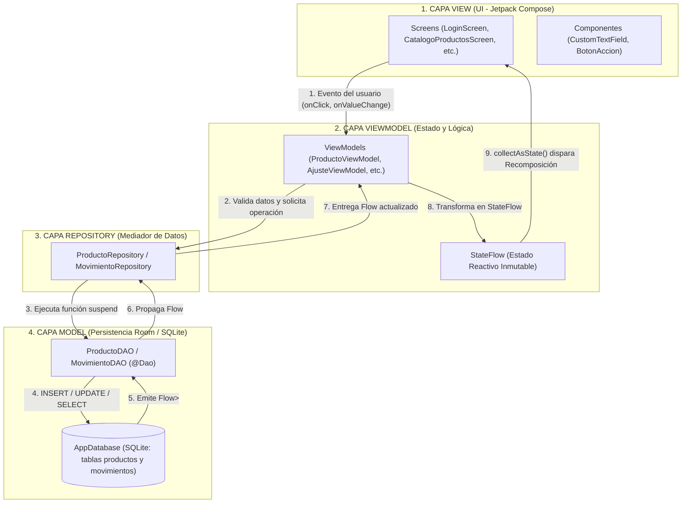
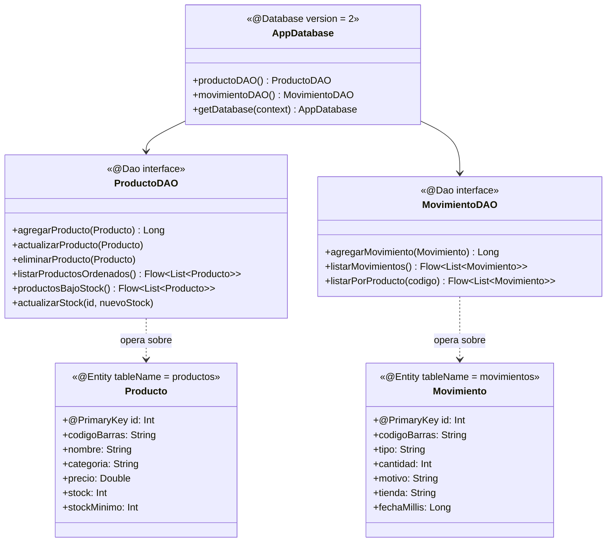

# Guía Maestra de Estudio, Presentación y Defensa Técnica
**Proyecto:** App Mobile de Inventario Multi-Tienda con Escaneo de Códigos (Caso BexAI)  
**Asignatura:** Desarrollo de Aplicaciones Móviles (`DSY1105`) — Duoc UC  
**Integrantes del Equipo:**
1. **Patricio Céspedes** — Flujo de Autenticación, Perfiles, Operaciones de Terreno y Navegación Principal
2. **Daniel Aedo** — Persistencia Local con Room, Catálogo CRUD, Conteo Físico, Diferencias e Historial
3. **Angelo Valenzuela** — Recursos Nativos (CameraX + ML Kit + Motor Háptico), Tablero Gerencial, Alertas y Reportes

---

## Capítulo 1: Análisis General del Proyecto

### 1.1 ¿Qué aplicación estamos desarrollando y cuál es su propósito?
Estamos desarrollando **MultiTienda (BexAI Inventory)**, una aplicación móvil nativa para **Android** diseñada para digitalizar el levantamiento, control y auditoría de stock en una red comercial compuesta por múltiples tiendas y bodegas (como *Bodega Pudahuel*, *Tienda Mall Plaza Oeste*, *Tienda Costanera Center*, etc.).

* **Problemática que resuelve:** En el caso de negocio BexAI, las tiendas llevaban su inventario en planillas Excel aisladas y hojas de papel. Esto causaba errores de digitación al escribir códigos de barra a mano, diferencias inexplicables en los conteos físicos, falta de trazabilidad sobre quién modificó el stock y demoras en detectar quiebres de stock.
* **Solución implementada:** Un MVP (Producto Mínimo Viable) funcional con **tres perfiles de usuario diferenciados** (*Operador*, *Encargado de Bodega* y *Gerencial*), lectura de códigos de barra con la cámara del teléfono en tiempo real, retroalimentación háptica (vibración), validación lógica desacoplada y persistencia de datos local con base de datos SQLite mediante **Room**.

---

### 1.2 Configuración Técnica y Versiones Reales del Proyecto
Toda la configuración de versiones se centraliza en el catálogo de versiones [`gradle/libs.versions.toml`](file:///c:/Users/patri/AndroidStudioProjects/MultiTienda/gradle/libs.versions.toml) y en [`app/build.gradle.kts`](file:///c:/Users/patri/AndroidStudioProjects/MultiTienda/app/build.gradle.kts):

| Parámetro / Herramienta | Valor en el Proyecto | ¿Qué significa técnicamente? |
| :--- | :--- | :--- |
| **Namespace / Application ID** | `com.example.multitienda` | Identificador único del paquete de la aplicación en Android. |
| **Lenguaje** | **Kotlin `2.2.10`** | Lenguaje oficial moderno para Android, conciso, seguro frente a nulos (*Null Safety*) y con soporte nativo de Corrutinas. |
| **Android Gradle Plugin (AGP)** | `9.5.0` | Motor de compilación oficial que empaqueta el código Kotlin y recursos en un archivo `.apk`. |
| **KSP (Kotlin Symbol Processing)** | `2.3.6` | Procesador de anotaciones ultrarrápido que lee las etiquetas `@Entity`, `@Dao` y `@Database` de Room y genera el código SQL automáticamente al compilar. |
| **`minSdk`** | `24` (Android 7.0 Nougat) | Versión mínima de Android en la que puede instalarse la app (cubre más del 97% de dispositivos activos). |
| **`targetSdk` / `compileSdk`** | `37` | Versión del SDK de Android con la que se compila y sobre la que se validan los permisos y comportamientos modernos. |
| **Compatibilidad JVM** | `JavaVersion.VERSION_11` | Estándar de bytecode Java utilizado por el compilador. |
| **Compose BOM** | `2026.02.01` | *Bill of Materials*: asegura que todas las librerías de Jetpack Compose usen versiones compatibles entre sí sin conflictos. |

---

### 1.3 Dependencias Declaradas y para qué sirve cada una

En [`app/build.gradle.kts`](file:///c:/Users/patri/AndroidStudioProjects/MultiTienda/app/build.gradle.kts) se declaran las siguientes librerías:

1. **Interfaz de Usuario (Jetpack Compose y Material 3):**
   * `androidx.compose.ui`, `ui-graphics`, `ui-tooling-preview`: Motor de dibujo declarativo de pantallas.
   * `androidx.compose.material3`: Componentes visuales modernos de Google (botones, tarjetas `ElevatedCard`, `Scaffold`, `TopAppBar`, `FilterChip`).
   * `androidx.compose.material:material-icons-extended`: Íconos vectoriales de Material Design (escáner QR, tienda, advertencias, historial, etc.).
   * `androidx.activity:activity-compose (1.13.0)`: Permite conectar la `MainActivity` con el árbol de funciones `@Composable` mediante `setContent { ... }`.

2. **Arquitectura MVVM y Ciclo de Vida:**
   * `androidx.lifecycle:lifecycle-runtime-ktx (2.11.0)`: Provee ámbitos de corrutinas ligados al ciclo de vida de la app.
   * `androidx.lifecycle:lifecycle-viewmodel-compose (2.11.0)`: Permite instanciar y observar `ViewModel` directamente dentro de funciones `@Composable` usando `viewModel()`.

3. **Navegación:**
   * `androidx.navigation:navigation-compose (2.8.4)`: Gestiona el cambio entre las 24 pantallas de la aplicación (`NavHost`, `NavController`, paso de argumentos tipados en rutas y control del historial de retroceso o *backstack*).

4. **Persistencia de Datos Local (Room 3):**
   * `androidx.room3:room3-runtime (3.0.3)` y `room3-common (3.0.3)`: Librería de abstracción sobre SQLite para guardar productos y movimientos de forma permanente en el teléfono.
   * `ksp(libs.androidx.room3.compiler)`: Compilador en tiempo de compilación que traduce nuestras interfaces DAO en consultas SQL reales.

5. **Recursos Nativos (Cámara e Inteligencia Artificial):**
   * `androidx.camera:camera-core`, `camera-camera2`, `camera-lifecycle`, `camera-view (1.4.0)`: **CameraX**, librería de Jetpack que controla el hardware de la cámara trasera y el flash/linterna adaptándose automáticamente al ciclo de vida de la pantalla.
   * `com.google.mlkit:barcode-scanning (17.3.0)`: **Google ML Kit**, motor de visión artificial que analiza cada fotograma de la cámara para detectar códigos de barras (`EAN-13`, `EAN-8`, `CODE-128`, `UPC-A`, `QR`).

---

### 1.4 Permisos de Hardware en `AndroidManifest.xml`
En [`app/src/main/AndroidManifest.xml`](file:///c:/Users/patri/AndroidStudioProjects/MultiTienda/app/src/main/AndroidManifest.xml) declaramos el acceso a los **dos recursos nativos exigidos por la rúbrica (Indicador IE 2.4.1)**:
```xml
<!-- RECURSO NATIVO 1: CÁMARA Y LINTERNA -->
<uses-feature android:name="android.hardware.camera" android:required="false" />
<uses-feature android:name="android.hardware.camera.flash" android:required="false" />
<uses-permission android:name="android.permission.CAMERA" />

<!-- RECURSO NATIVO 2: VIBRACIÓN Y RESPUESTA HÁPTICA -->
<uses-permission android:name="android.permission.VIBRATE" />
```
> [!TIP]
> **Dato clave para el profesor:** Se puso `android:required="false"` en `<uses-feature>` para que la aplicación también pueda instalarse y ejecutarse en emuladores o tablets que no tengan flash físico, ofreciendo además una pantalla de **Entrada Manual de Código** como respaldo.

---

## Capítulo 2: Estructura de Carpetas y Archivos

El código fuente se ubica en `app/src/main/java/com/example/multitienda/` y sigue una estructura modular por capas:

```text
com.example.multitienda/
├── MainActivity.kt                        # Único punto de entrada (Single-Activity Architecture)
├── modelo/                                # CAPA MODEL: Entidades Room, DAOs y Modelos de Formulario
│   ├── Producto.kt                        # @Entity tabla "productos"
│   ├── ProductoDAO.kt                     # @Dao consultas SQL para productos
│   ├── Movimiento.kt                      # @Entity tabla "movimientos"
│   ├── MovimientoDAO.kt                   # @Dao consultas SQL para movimientos
│   ├── ProductoFormModel.kt               # Modelo de estado y errores del formulario de producto
│   └── FormularioModel.kt                 # Modelo base de validación de formulario
├── data/
│   └── repository/                        # CAPA REPOSITORY: Mediador entre DAOs y ViewModels
│       ├── ProductoRepository.kt          # Lógica de acceso a productos + semilla inicial (6 productos)
│       └── MovimientoRepository.kt        # Lógica de acceso al historial de movimientos
├── viewmodel/                             # CAPA VIEWMODEL: Lógica de negocio, validaciones y StateFlow
│   ├── AppDatabase.kt                     # @Database configuración Singleton de Room (versión 2)
│   ├── LoginViewModel.kt                  # Autenticación, validación de credenciales y selección de perfil
│   ├── ProductoViewModel.kt               # CRUD de catálogo, búsqueda reactiva y conteo físico
│   ├── AjusteViewModel.kt                 # Cálculo de entradas, salidas, validación de stock y registro
│   ├── DashboardViewModel.kt              # Cálculo reactivo de KPIs gerenciales (SKUs, unidades, % quiebre)
│   ├── HistorialViewModel.kt              # Filtrado reactivo de transacciones de auditoría
│   └── ReposicionViewModel.kt             # Solicitud y abastecimiento por quiebre de stock
├── util/                                  # UTILIDADES NATIVAS
│   └── HapticFeedbackHelper.kt            # Controlador del motor de vibración física (API 24 a 37)
└── ui/                                    # CAPA VIEW (Interfaz de Usuario en Jetpack Compose)
    ├── components/                        # Componentes visuales reutilizables
    │   ├── BotonAccion.kt                 # Botón corporativo con animación de carga (AnimatedVisibility)
    │   └── CustomTextField.kt             # Campo de texto validado con ícono de alerta y mensaje de error
    ├── navigation/                        # Enrutamiento central
    │   ├── AppRoutes.kt                   # Constantes de rutas y constructores de argumentos URI
    │   └── AppNavigation.kt               # NavHost principal que conecta las 24 pantallas
    ├── theme/                             # Diseño visual Material 3
    │   ├── Color.kt                       # Paleta de colores corporativa
    │   ├── Theme.kt                       # Configuración de MultiTiendaTheme (claro/oscuro)
    │   └── Type.kt                        # Tipografías y tamaños de texto
    └── screens/                           # Pantallas organizadas por dominio funcional
        ├── operador/                      # Módulo Patricio (7 pantallas)
        │   ├── SplashScreen.kt
        │   ├── LoginScreen.kt
        │   ├── SeleccionTiendaScreen.kt
        │   ├── MenuOperadorScreen.kt
        │   ├── FormularioAjusteScreen.kt
        │   ├── ResumenMovimientoScreen.kt
        │   └── PerfilUsuarioScreen.kt
        ├── inventario/                    # Módulo Daniel (10 archivos: 8 pantallas + 2 componentes/nav)
        │   ├── InventarioNavigation.kt
        │   ├── CatalogoProductosScreen.kt
        │   ├── DetalleProductoScreen.kt
        │   ├── CrearProductoScreen.kt
        │   ├── EditarProductoScreen.kt
        │   ├── ConfirmarEliminarScreen.kt
        │   ├── ConteoFisicoScreen.kt
        │   ├── DiferenciasStockScreen.kt
        │   ├── HistorialMovimientosScreen.kt
        │   ├── ProductoCard.kt
        │   └── ProductoFormulario.kt
        ├── scanner/                       # Módulo Angelo - Escaneo (3 pantallas)
        │   ├── ScannerScreen.kt
        │   ├── ResultadoScannerScreen.kt
        │   └── EntradaManualCodigoScreen.kt
        └── gerencial/                     # Módulo Angelo - Supervisión y Gerencia (6 pantallas)
            ├── DashboardGerencialScreen.kt
            ├── AlertasQuiebreScreen.kt
            ├── DeclararReposicionScreen.kt
            ├── ConfigHardwareScreen.kt
            ├── AdminTiendasScreen.kt
            └── ExportarReportesScreen.kt
```

---

## Capítulo 3: Arquitectura del Proyecto — Patrón MVVM

### 3.1 ¿Qué es MVVM?
**MVVM** significa **Model – View – ViewModel** (Modelo – Vista – VistaModelo). Es el patrón arquitectónico oficial recomendado por Google para el desarrollo de aplicaciones Android modernas. Su propósito principal es **separar la interfaz gráfica (lo que el usuario ve) de la lógica de negocio y de los datos (cómo funciona el sistema por dentro)**.

### 3.2 Las Capas de nuestra Arquitectura



1. **Model (`modelo/` y `data/repository/`):**
   * Representa los datos reales de la aplicación y las reglas de almacenamiento.
   * Incluye las entidades [`Producto.kt`](file:///c:/Users/patri/AndroidStudioProjects/MultiTienda/app/src/main/java/com/example/multitienda/modelo/Producto.kt) y [`Movimiento.kt`](file:///c:/Users/patri/AndroidStudioProjects/MultiTienda/app/src/main/java/com/example/multitienda/modelo/Movimiento.kt), los DAOs y los Repositorios.
   * **Regla de oro:** El Modelo *no sabe que existe una pantalla ni botones*.

2. **View (`ui/screens/` y `ui/components/`):**
   * Es la interfaz visual escrita con funciones `@Composable`.
   * Su única responsabilidad es **mostrar el estado actual** en pantalla y **avisar al ViewModel** cuando el usuario toca un botón o escribe texto.
   * **Regla de oro:** La Vista *nunca hace cálculos matemáticos de stock ni consultas SQL directas*.

3. **ViewModel (`viewmodel/`):**
   * Es el "cerebro" intermediario entre la Vista y el Modelo.
   * Recibe las acciones del usuario desde la Vista, valida que los campos sean correctos (por ejemplo, que el precio no sea negativo o que haya stock suficiente para una salida), llama al Repositorio en segundo plano usando corrutinas (`viewModelScope.launch`) y expone el resultado en variables observables (`StateFlow`).
   * **Regla de oro:** El ViewModel *nunca tiene referencias a botones ni componentes de Compose*, lo que evita fugas de memoria (*memory leaks*) cuando se gira la pantalla.

---

### 3.3 Flujo Unidireccional de Datos (UDF): Ejemplo Real Paso a Paso
Veamos qué ocurre exactamente en el código cuando un Operador realiza un **Conteo Físico** en [`ConteoFisicoScreen.kt`](file:///c:/Users/patri/AndroidStudioProjects/MultiTienda/app/src/main/java/com/example/multitienda/ui/screens/inventario/ConteoFisicoScreen.kt):

1. **Acción del Usuario (Evento hacia abajo):** El usuario escribe `"20"` en el campo *"Conteo real en pasillo"* y presiona el botón `"Registrar Conteo"`.
2. **La Vista invoca al ViewModel:** La pantalla ejecuta:
   ```kotlin
   onRegistrar = { viewModel.registrarConteo(productoId, conteo, tienda, motivo) }
   ```
3. **El ViewModel valida la lógica:** En [`ProductoViewModel.kt`](file:///c:/Users/patri/AndroidStudioProjects/MultiTienda/app/src/main/java/com/example/multitienda/viewmodel/ProductoViewModel.kt#L212-L234), la función `registrarConteo` verifica si `nuevoStock` es un número entero mayor o igual a 0. Si el usuario escribió letras o un número negativo, actualiza `_conteoError.value = "Ingrese un conteo válido (0 o más)"` y detiene la operación.
4. **Corrutina y llamada al Repositorio:** Si el dato es válido, abre una corrutina con `viewModelScope.launch`, calcula la diferencia (`nuevoStock - producto.stock`), actualiza el stock en `productoRepository.actualizarStock(id, nuevoStock)` y guarda el registro de auditoría en `movimientoRepository.registrar(...)`.
5. **Room actualiza SQLite y notifica:** Room ejecuta el `UPDATE` en el archivo físico de base de datos y automáticamente emite la nueva lista por el `Flow<List<Producto>>`.
6. **Actualización de la Interfaz (Estado hacia arriba):** El ViewModel pone `_conteoGuardado.value = true`. La pantalla, que está observando esa variable mediante `val guardado by viewModel.conteoGuardado.collectAsState()`, detecta el cambio y regresa automáticamente a la pantalla anterior mostrando el nuevo stock actualizado.

---

## Capítulo 4: Componentes e Interfaz de Usuario (Jetpack Compose)

### 4.1 ¿Qué es Jetpack Compose?
Antiguamente en Android las interfaces se creaban con archivos `XML` separados del código Kotlin y había que usar `findViewById()` para modificar cada texto manualmente (programación imperativa).  
**Jetpack Compose** es el kit de herramientas moderno de Android que usa **programación declarativa**: escribimos funciones en Kotlin anotadas con `@Composable` que describen *cómo debe verse la pantalla para un estado dado*. Cuando un dato cambia, Compose vuelve a ejecutar automáticamente solo las funciones que dependen de ese dato. A este proceso se le llama **Recomposición**.

### 4.2 Diferencia entre una Pantalla (*Screen*) y un Componente Reutilizable
* **Componente Reutilizable (`ui/components/`):** Es una pieza visual pequeña, genérica e independiente que se usa en muchas partes de la app (como un ladrillo de Lego). No tiene `ViewModel` propio; recibe todo por parámetros.
* **Pantalla o *Screen* (`ui/screens/`):** Es una vista completa que representa una ruta de navegación (por ejemplo, `LoginScreen` o `CatalogoProductosScreen`). Combina varios componentes reutilizables y se conecta con un `ViewModel`.

---

### 4.3 Análisis de los Componentes Reutilizables de Nuestro Proyecto

#### 1. [`CustomTextField.kt`](file:///c:/Users/patri/AndroidStudioProjects/MultiTienda/app/src/main/java/com/example/multitienda/ui/components/CustomTextField.kt) (Cumple Indicador IE 2.1.2 de la Rúbrica)
Es nuestro campo de formulario estandarizado con validación visual integrada:
```kotlin
@Composable
fun CustomTextField(
    value: String,
    onValueChange: (String) -> Unit,
    label: String,
    modifier: Modifier = Modifier,
    isError: Boolean = false,
    errorMessage: String? = null,
    // ...
)
```
* **¿Cómo funciona?:** Envuelve un `OutlinedTextField` de Material 3 dentro de un `Column`.
* **Retroalimentación visual automática:** Si `isError` es `true`, el borde de la caja se pinta de rojo (`MaterialTheme.colorScheme.error`), muestra automáticamente un ícono de advertencia (`Icons.Default.Warning`) a la derecha y despliega debajo el texto con la explicación del error (`errorMessage`).
* **Elevación de estado (*State Hoisting*):** `CustomTextField` no guarda el texto adentro suyo; recibe `value` desde afuera y avisa cada tecla pulsada mediante la función lambda `onValueChange`. Esto permite que el `ViewModel` valide el texto en tiempo real.

#### 2. [`BotonAccion.kt`](file:///c:/Users/patri/AndroidStudioProjects/MultiTienda/app/src/main/java/com/example/multitienda/ui/components/BotonAccion.kt) (Cumple Indicador IE 2.2.2 de Animaciones Funcionales)
Es el botón principal de confirmación en los formularios:
```kotlin
AnimatedVisibility(visible = isLoading, enter = fadeIn(), exit = fadeOut()) {
    Row(verticalAlignment = Alignment.CenterVertically) {
        CircularProgressIndicator(modifier = Modifier.size(20.dp), strokeWidth = 2.dp)
        Spacer(modifier = Modifier.width(8.dp))
    }
}
Text(text = if (isLoading) "Procesando..." else texto)
```
* **¿Por qué es importante para la evaluación?:** Integra `AnimatedVisibility` con transiciones `fadeIn()` y `fadeOut()`. Cuando `isLoading` pasa a `true` (por ejemplo, al iniciar sesión o guardar un producto), el botón se deshabilita (`enabled = enabled && !isLoading`) para evitar dobles clics accidentales, aparece suavemente un indicador circular girando y el texto cambia a `"Procesando..."`.

---

## Capítulo 5: ViewModel y Gestión de Estados

### 5.1 ¿Qué es un ViewModel y por qué sobrevive a cambios de configuración?
En Android, cuando el usuario gira el teléfono de vertical a horizontal o cambia el idioma/modo oscuro, el sistema operativo **destruye y vuelve a crear la `MainActivity`**. Si guardáramos los datos en variables comunes dentro de la pantalla, todo lo escrito por el usuario se borraría.
* Un **`ViewModel`** vive en un espacio de memoria separado administrado por Jetpack Lifecycle que **no se destruye cuando la pantalla rota**, conservando intactos los datos y las operaciones en curso.
* **`ViewModel` vs `AndroidViewModel`:**
  * [`LoginViewModel`](file:///c:/Users/patri/AndroidStudioProjects/MultiTienda/app/src/main/java/com/example/multitienda/viewmodel/LoginViewModel.kt) hereda de `ViewModel()` porque solo valida credenciales en memoria.
  * [`ProductoViewModel`](file:///c:/Users/patri/AndroidStudioProjects/MultiTienda/app/src/main/java/com/example/multitienda/viewmodel/ProductoViewModel.kt), [`AjusteViewModel`](file:///c:/Users/patri/AndroidStudioProjects/MultiTienda/app/src/main/java/com/example/multitienda/viewmodel/AjusteViewModel.kt), [`DashboardViewModel`](file:///c:/Users/patri/AndroidStudioProjects/MultiTienda/app/src/main/java/com/example/multitienda/viewmodel/DashboardViewModel.kt), [`HistorialViewModel`](file:///c:/Users/patri/AndroidStudioProjects/MultiTienda/app/src/main/java/com/example/multitienda/viewmodel/HistorialViewModel.kt) y [`ReposicionViewModel`](file:///c:/Users/patri/AndroidStudioProjects/MultiTienda/app/src/main/java/com/example/multitienda/viewmodel/ReposicionViewModel.kt) heredan de `AndroidViewModel(application)` porque necesitan el contexto global `Application` para inicializar la base de datos Room (`AppDatabase.getDatabase(application)`).

---

### 5.2 Diferencia entre Variable Común, `MutableStateFlow` y `StateFlow`

| Tipo de Variable | ¿Compose detecta cuando cambia? | ¿Dónde se usa? |
| :--- | :---: | :--- |
| `var contador = 0` (Variable común) | **NO.** Aunque cambie su valor, la pantalla no se redibuja. | Cálculos internos temporales dentro de una función. |
| `_state = MutableStateFlow(...)` | **SÍ (Lectura y Escritura).** | Privado (`private`) dentro del `ViewModel` para que solo el ViewModel pueda modificar el estado. |
| `state: StateFlow<...> = _state.asStateFlow()` | **SÍ (Solo Lectura).** | Público en el `ViewModel` para que la pantalla lo observe con `collectAsState()` sin poder alterarlo directamente. |

> [!IMPORTANT]
> **Patrón de Encapsulamiento (*Backing Property*):** En todos nuestros ViewModels verás un par de variables: una con guion bajo (`private val _form = MutableStateFlow(...)`) y otra sin guion bajo (`val form: StateFlow<...> = _form.asStateFlow()`). Si el profesor pregunta por qué hay dos variables para lo mismo, la respuesta es: **«Por encapsulamiento y seguridad arquitectónica: el ViewModel tiene permiso de escritura con `MutableStateFlow`, pero la interfaz visual solo tiene permiso de lectura con `StateFlow`»**.

---

### 5.3 Resumen de los 6 ViewModels del Proyecto

1. **[`LoginViewModel.kt`](file:///c:/Users/patri/AndroidStudioProjects/MultiTienda/app/src/main/java/com/example/multitienda/viewmodel/LoginViewModel.kt):**
   * Valida formato de correo (`@`), campos vacíos, existencia del usuario en el mapa `USUARIOS` y contraseña válida (`1234`, `123456`, `admin123`).
   * Incluye `seleccionarPerfilRapido(rol)` para autocompletar credenciales de *Operador*, *Bodega* o *Gerencial* durante la demostración.
2. **[`ProductoViewModel.kt`](file:///c:/Users/patri/AndroidStudioProjects/MultiTienda/app/src/main/java/com/example/multitienda/viewmodel/ProductoViewModel.kt):**
   * Combina en tiempo real el flujo de productos de Room con el texto del buscador usando el operador `combine(productoRepository.productos, _busqueda)`.
   * Gestiona la validación completa del formulario (`guardar()`), verifica que no se dupliquen códigos de barras (`obtenerPorCodigo(codigo)`), ejecuta altas, bajas, modificaciones y conteos físicos, creando automáticamente un registro en `MovimientoRepository` cada vez que varía el stock.
3. **[`AjusteViewModel.kt`](file:///c:/Users/patri/AndroidStudioProjects/MultiTienda/app/src/main/java/com/example/multitienda/viewmodel/AjusteViewModel.kt):**
   * Procesa los movimientos directos del Operador (*Entrada*, *Salida*, *Ajuste / Conteo*).
   * Impide salidas cuando la cantidad supera el stock actual (`if (cantidad > producto.stock) -> "Stock insuficiente"`).
4. **[`DashboardViewModel.kt`](file:///c:/Users/patri/AndroidStudioProjects/MultiTienda/app/src/main/java/com/example/multitienda/viewmodel/DashboardViewModel.kt):**
   * Usa el operador reactivo `.map { lista -> ... }` sobre el flujo de Room para calcular automáticamente `totalSkus`, `totalUnidades`, `totalQuiebres` (`stock <= stockMinimo`) y `porcentajeQuiebre`.
5. **[`HistorialViewModel.kt`](file:///c:/Users/patri/AndroidStudioProjects/MultiTienda/app/src/main/java/com/example/multitienda/viewmodel/HistorialViewModel.kt):**
   * Filtra reactivamente la tabla `movimientos` por código de barras o por tipo de movimiento (*Entrada*, *Salida*, *Conteo*).
6. **[`ReposicionViewModel.kt`](file:///c:/Users/patri/AndroidStudioProjects/MultiTienda/app/src/main/java/com/example/multitienda/viewmodel/ReposicionViewModel.kt):**
   * Permite al Encargado de Bodega o Gerente declarar una reposición urgente sobre un artículo en quiebre, sumando las nuevas unidades al stock y dejando constancia en el historial con tipo `"Entrada / Reposición"`.

---

## Capítulo 6: Base de Datos Local con Room

### 6.1 ¿Qué es Room y qué relación tiene con SQLite?
Android incluye de fábrica un motor de base de datos relacional llamado **SQLite**. Sin embargo, usar SQLite directamente ("en crudo") obliga a escribir mucho código repetitivo (`Cursor`, `ContentValues`), no revisa si escribiste mal una consulta SQL hasta que la app se cae en ejecución y no se integra nativamente con `Flow` o Corrutinas.

**Room** es la capa de abstracción (ORM — *Object-Relational Mapping*) oficial de Android Jetpack sobre SQLite. Transforma tablas SQL en clases de datos Kotlin (`data class`) y verifica en **tiempo de compilación** (gracias al plugin KSP) que todas nuestras consultas SQL estén bien escritas.

---

### 6.2 Los 3 Pilares de Room en Nuestro Proyecto



#### 1. `@Entity` (Las Tablas):
* **[`Producto.kt`](file:///c:/Users/patri/AndroidStudioProjects/MultiTienda/app/src/main/java/com/example/multitienda/modelo/Producto.kt):** Define la tabla `"productos"`. Su clave primaria es `@PrimaryKey(autoGenerate = true) val id: Int = 0`, lo que hace que SQLite le asigne un ID correlativo automático (`1, 2, 3...`).
* **[`Movimiento.kt`](file:///c:/Users/patri/AndroidStudioProjects/MultiTienda/app/src/main/java/com/example/multitienda/modelo/Movimiento.kt):** Define la tabla `"movimientos"`. Se relaciona lógicamente con `Producto` a través del atributo `codigoBarras: String` y registra la marca de tiempo exacta en milisegundos (`val fechaMillis: Long = System.currentTimeMillis()`).

#### 2. `@Dao` (*Data Access Object* — Las Consultas SQL):
* **[`ProductoDAO.kt`](file:///c:/Users/patri/AndroidStudioProjects/MultiTienda/app/src/main/java/com/example/multitienda/modelo/ProductoDAO.kt):** Define las operaciones SQL sobre la tabla `productos`:
  * `@Insert suspend fun agregarProducto(producto: Producto): Long`
  * `@Update suspend fun actualizarProducto(producto: Producto)`
  * `@Delete suspend fun eliminarProducto(producto: Producto)`
  * `@Query("SELECT * FROM productos WHERE stock <= stockMinimo ORDER BY stock ASC") fun productosBajoStock(): Flow<List<Producto>>`
  * `@Query("UPDATE productos SET stock = :nuevoStock WHERE id = :id") suspend fun actualizarStock(id: Int, nuevoStock: Int)`
* **¿Por qué algunas funciones llevan `suspend` y otras devuelven `Flow<...>`?:**
  * Las operaciones de escritura o lectura única (`@Insert`, `@Update`, `@Delete`, `obtenerPorId`) llevan **`suspend`** para ejecutarse dentro de una corrutina fuera del hilo principal (*Main Thread*) y no congelar la pantalla.
  * Las consultas de listado (`listarProductosOrdenados()`, `productosBajoStock()`) devuelven **`Flow<List<Producto>>`**, que es un canal reactivo continuo: cada vez que cambia cualquier fila en la tabla `productos`, Room vuelve a emitir la lista actualizada automáticamente sin que tengamos que volver a pedirla.

#### 3. `@Database` (El Motor Central):
* **[`AppDatabase.kt`](file:///c:/Users/patri/AndroidStudioProjects/MultiTienda/app/src/main/java/com/example/multitienda/viewmodel/AppDatabase.kt):** Une las entidades `[Producto::class, Movimiento::class]` en la base de datos llamada `"base_productos"`.
* **¿Dónde se guarda físicamente?:** En la memoria interna privada del teléfono, en la ruta protegida `/data/data/com.example.multitienda/databases/base_productos`. Por eso, **aunque cierres la aplicación o reinicies el teléfono, los productos y movimientos siguen guardados**.

---

## Capítulo 7: Repositorios y Flujo de Datos

### 7.1 ¿Qué es un Repository y por qué existe esta capa?
Un **Repositorio** ([`ProductoRepository.kt`](file:///c:/Users/patri/AndroidStudioProjects/MultiTienda/app/src/main/java/com/example/multitienda/data/repository/ProductoRepository.kt) y [`MovimientoRepository.kt`](file:///c:/Users/patri/AndroidStudioProjects/MultiTienda/app/src/main/java/com/example/multitienda/data/repository/MovimientoRepository.kt)) es una clase que actúa como **única fuente de verdad (*Single Source of Truth*)** para los ViewModels.

* **¿Por qué no llamar al DAO directamente desde el ViewModel?:**
  1. **Desacoplamiento:** Si en el futuro conectamos la app a una API REST en Spring Boot (como proyecta la Fase 2 del caso BexAI), solo modificamos el `ProductoRepository` para que sincronice Room con internet, y **ninguno de los 6 ViewModels ni las 24 pantallas tendrá que cambiarse**.
  2. **Reutilización:** Cuatro ViewModels distintos (`ProductoViewModel`, `AjusteViewModel`, `DashboardViewModel` y `ReposicionViewModel`) usan `ProductoRepository` sin duplicar consultas ni la lógica de carga inicial.
  3. **Semilla de Datos Inicial (`sembrarSiVacio()`):** En [`ProductoRepository.kt`](file:///c:/Users/patri/AndroidStudioProjects/MultiTienda/app/src/main/java/com/example/multitienda/data/repository/ProductoRepository.kt#L30-L34), la función verifica `if (dao.contarProductos() == 0)` e inserta los 6 productos sintéticos de prueba (*Leche Entera 1L*, *Arroz Grado 1*, *Aceite Vegetal*, *Detergente*, *Agua Mineral* y *Café Molido*).

---

## Capítulo 8: Funcionamiento Integral de la Aplicación y Perfiles

### 8.1 Comportamiento según el Perfil de Usuario
Al iniciar sesión en [`LoginScreen.kt`](file:///c:/Users/patri/AndroidStudioProjects/MultiTienda/app/src/main/java/com/example/multitienda/ui/screens/operador/LoginScreen.kt), el sistema identifica el rol del usuario y adapta dinámicamente el Menú Principal ([`MenuOperadorScreen.kt`](file:///c:/Users/patri/AndroidStudioProjects/MultiTienda/app/src/main/java/com/example/multitienda/ui/screens/operador/MenuOperadorScreen.kt)):

| Perfil | Credencial de Prueba (Clave: `1234`) | Herramientas Habilitadas en su Menú |
| :--- | :--- | :--- |
| **1. Operador de Terreno** | `test1@bexai.cl` o `operador@bexai.cl` | • Cambiar sucursal/bodega activa<br>• **Escanear Producto** (Cámara CameraX + ML Kit)<br>• **Registrar Movimiento** (Entrada, Salida, Ajuste)<br>• **Conteo Físico** en pasillo |
| **2. Encargado de Bodega** | `test2@bexai.cl` o `bodega@bexai.cl` | • Cambiar sucursal/bodega activa<br>• **Consultar Stock Disponible** (Catálogo completo y CRUD)<br>• **Control de Diferencias** (Auditoría sistema vs físico)<br>• **Alertas de Reposición** y declaración de pedidos |
| **3. Perfil Gerencial** | `test3@bexai.cl` o `gerente@bexai.cl` | • **Tablero Analítico (Dashboard)** con KPIs en tiempo real<br>• **Auditoría de Existencias Globales**<br>• **Alertas de Quiebre de Stock**<br>• **Historial de Modificaciones** (Trazabilidad completa)<br>• **Administración de Tiendas** habilitadas<br>• **Exportar Reportes** (Excel `.xlsx` / `.csv`) |

### 8.2 ¿Qué está 100% persistido en Room y qué está simulado para el MVP?
Es fundamental ser transparentes y precisos ante el profesor:
* **100% Real y Funcional en Dispositivo:**
  * Base de datos SQLite con **Room 3** para crear, editar, eliminar productos, cambiar stocks, hacer conteos físicos y guardar cada movimiento con fecha y tienda.
  * Escáner de cámara en tiempo real con **CameraX + Google ML Kit** y control físico del **flash/linterna**.
  * Motor de **vibración háptica física** (`Vibrator` / `VibratorManager`) al detectar códigos o alertas.
  * Cálculo matemático reactivo de KPIs, diferencias de stock y quiebres reales según los datos en Room.
* **Simulado Localmente (según restricciones de la sección 3.4 y 5.1 del Caso BexAI):**
  * **Autenticación (`LoginViewModel`):** Valida contra un diccionario local seguro de usuarios de prueba sin requerir un servidor externo activo.
  * **Exportación a Excel/CSV (`ExportarReportesScreen`) y Administración de Tiendas (`AdminTiendasScreen`):** Simulan localmente la generación del archivo de reporte tomando las métricas reales de Room y la habilitación de sucursales en memoria, cumpliendo exactamente la regla del caso: *"El despliegue de exportación de reportes a Excel se simulará localmente... Queda estrictamente denegado el enlace con ERPs, POS o ambientes de producción"*.

---

## Capítulo 9: Explicación de Código Importante (Línea por Línea)

### 9.1 [`AppDatabase.kt`](file:///c:/Users/patri/AndroidStudioProjects/MultiTienda/app/src/main/java/com/example/multitienda/viewmodel/AppDatabase.kt) — El Patrón Singleton de Base de Datos
```kotlin
@Database(entities = [Producto::class, Movimiento::class], version = 2, exportSchema = false)
abstract class AppDatabase : RoomDatabase() {
    abstract fun productoDAO(): ProductoDAO
    abstract fun movimientoDAO(): MovimientoDAO

    companion object {
        @Volatile
        private var INSTANCIA: AppDatabase? = null

        fun getDatabase(context: Context): AppDatabase {
            return INSTANCIA ?: synchronized(this) {
                val instancia = Room.databaseBuilder(
                    context,
                    AppDatabase::class.java,
                    "base_productos"
                ).fallbackToDestructiveMigration().build()
                INSTANCIA = instancia
                instancia
            }
        }
    }
}
```
* **¿Por qué se implementó con `@Volatile` y `synchronized(this)`?:** Abrir una conexión a una base de datos SQLite es una operación muy costosa en memoria y CPU. El patrón **Singleton** garantiza que en toda la aplicación exista **una única instancia abierta** (`INSTANCIA`). `@Volatile` asegura que cualquier hilo de ejecución vea siempre el valor más reciente de `INSTANCIA`, y `synchronized(this)` evita que dos corrutinas creen dos bases de datos al mismo tiempo.
* **¿Qué hace `.fallbackToDestructiveMigration()`?:** Si subimos la versión de la base de datos (por ejemplo, de `version = 1` a `version = 2` cuando se agregó la tabla `Movimiento`), Room recrea las tablas limpiamente sin que la app sufra un cierre forzoso (`IllegalStateException`).

---

### 9.2 [`ProductoViewModel.kt`](file:///c:/Users/patri/AndroidStudioProjects/MultiTienda/app/src/main/java/com/example/multitienda/viewmodel/ProductoViewModel.kt) — Búsqueda Reactiva con `combine` y `stateIn`
```kotlin
val productos: StateFlow<List<Producto>> =
    combine(productoRepository.productos, _busqueda) { lista, texto ->
        if (texto.isBlank()) lista
        else lista.filter { it.nombre.contains(texto, ignoreCase = true) }
    }.stateIn(
        viewModelScope,
        SharingStarted.WhileSubscribed(5000),
        emptyList()
    )
```
* **¿Cómo explicarlo oralmente?:**
  * `combine` une dos flujos de datos: la lista de productos que viene de Room (`productoRepository.productos`) y el texto que el usuario escribe en el buscador (`_busqueda`).
  * Cada vez que el usuario escribe una letra **o** cada vez que se agrega/edita un producto en la base de datos, ese bloque se ejecuta automáticamente y filtra la lista ignorando mayúsculas/minúsculas (`ignoreCase = true`).
  * `SharingStarted.WhileSubscribed(5000)` mantiene vivo el flujo hasta 5 segundos después de que la pantalla desaparece. Así, si el usuario gira el teléfono (que toma ~300 ms), no se vuelve a consultar la base de datos desde cero.

---

### 9.3 [`ScannerScreen.kt`](file:///c:/Users/patri/AndroidStudioProjects/MultiTienda/app/src/main/java/com/example/multitienda/ui/screens/scanner/ScannerScreen.kt) — Integración de CameraX y Google ML Kit
* **Permisos en tiempo de ejecución:** Usa `rememberLauncherForActivityResult(ActivityResultContracts.RequestPermission())` para pedir permiso `Manifest.permission.CAMERA` al usuario de forma segura.
* **Puente con vistas nativas (`AndroidView`):** Como `PreviewView` de CameraX es un componente del sistema Android tradicional, se integra dentro de Jetpack Compose mediante el contenedor `AndroidView(factory = { ... })`.
* **Análisis de fotogramas (`ImageAnalysis`):**
  * Usa `ImageAnalysis.STRATEGY_KEEP_ONLY_LATEST` para analizar solo el último fotograma disponible de la cámara sin acumular cola ni ralentizar el teléfono.
  * Convierte el frame en un `InputImage` y se lo pasa a `BarcodeScanning.getClient(...)`.
  * Cuando detecta un código, marca `codigoYaProcesado = true` (para no disparar 30 lecturas repetidas en un segundo), cierra el `imageProxy.close()` y navega al resultado.

---

### 9.4 [`HapticFeedbackHelper.kt`](file:///c:/Users/patri/AndroidStudioProjects/MultiTienda/app/src/main/java/com/example/multitienda/util/HapticFeedbackHelper.kt) — Compatibilidad Multi-API de Vibración
* En Android 12 (API 31 / `Build.VERSION_CODES.S`), Google deprecó el servicio antiguo `VIBRATOR_SERVICE` e introdujo `VIBRATOR_MANAGER_SERVICE`.
* Nuestro helper comprueba `if (Build.VERSION.SDK_INT >= Build.VERSION_CODES.S)` para usar `VibratorManager` en teléfonos modernos y hace *fallback* automático a `Vibrator` y `VibrationEffect.createOneShot(...)` en teléfonos con Android 7 a 11. Además envuelve todo en un `try-catch` para que nunca falle en un emulador de PC sin motor vibrador físico.

---

## Capítulo 10: Banco de Preguntas Técnicas del Docente

### Nivel Básico

1. **¿Qué es Kotlin y por qué lo usamos en lugar de Java?**
   * *Respuesta técnica:* Es un lenguaje de programación estáticamente tipado desarrollado por JetBrains que corre sobre la JVM y es el lenguaje oficial de Android. Ofrece seguridad contra punteros nulos (*Null Safety* con `?`), `data class`, funciones de orden superior y soporte nativo para Corrutinas.
   * *Versión oral breve:* «Es el lenguaje oficial de Android; nos permite escribir código más corto, seguro contra errores de valores nulos y usar Jetpack Compose y corrutinas para no bloquear la pantalla».
   * *Ejemplo en el proyecto:* Nuestras entidades como `data class Producto(...)` ahorran decenas de líneas de getters y setters que exigiría Java.

2. **¿Qué es una Activity y cuántas tiene nuestro proyecto?**
   * *Respuesta técnica:* Una `Activity` es el componente de Android que provee una ventana donde la app dibuja su interfaz. Nuestro proyecto sigue la arquitectura moderna de **Single-Activity** (Actividad Única): solo tenemos [`MainActivity.kt`](file:///c:/Users/patri/AndroidStudioProjects/MultiTienda/app/src/main/java/com/example/multitienda/MainActivity.kt), y dentro de ella todas las 24 pantallas son funciones `@Composable` intercambiadas por `Navigation Compose`.
   * *Versión oral breve:* «Solo tenemos una `MainActivity`. En vez de crear 24 Activities pesadas, usamos una sola Activity como contenedor y navegamos entre 24 pantallas ligeras hechas en Jetpack Compose».

3. **¿Qué es un componente `@Composable`?**
   * *Respuesta técnica:* Es una función en Kotlin anotada con `@Composable` que transforma datos (estado) en elementos de interfaz gráfica dentro del árbol de Jetpack Compose.
   * *Versión oral breve:* «Es un bloque de construcción visual en Jetpack Compose, como nuestro `BotonAccion` o `CustomTextField`, que se dibuja en pantalla según los parámetros que recibe».

---

### Nivel Intermedio

4. **¿Qué diferencia hay entre la Vista (Screen) y el ViewModel?**
   * *Respuesta técnica:* La Vista (`Screen`) solo se encarga de renderizar la UI en pantalla y capturar interacciones del usuario; no contiene reglas de negocio ni consultas a base de datos. El `ViewModel` contiene la lógica de validación, transforma los flujos de datos de los repositorios en `StateFlow` y sobrevive a cambios de configuración como giros de pantalla.
   * *Versión oral breve:* «La Vista es lo que el usuario ve y toca; el ViewModel es el cerebro que valida los datos y se comunica con el repositorio sin perder la información si se gira el teléfono».
   * *Ejemplo en el proyecto:* [`FormularioAjusteScreen.kt`](file:///c:/Users/patri/AndroidStudioProjects/MultiTienda/app/src/main/java/com/example/multitienda/ui/screens/operador/FormularioAjusteScreen.kt) dibuja el formulario, pero es [`AjusteViewModel.kt`](file:///c:/Users/patri/AndroidStudioProjects/MultiTienda/app/src/main/java/com/example/multitienda/viewmodel/AjusteViewModel.kt) quien decide si una salida es válida o si el stock es insuficiente.

5. **¿Cómo funciona la navegación entre pantallas y qué hace `popUpTo`?**
   * *Respuesta técnica:* Usamos `NavHost` y `NavController` en [`AppNavigation.kt`](file:///c:/Users/patri/AndroidStudioProjects/MultiTienda/app/src/main/java/com/example/multitienda/ui/navigation/AppNavigation.kt). Las pantallas se apilan en un *Backstack* (pila de historial). Cuando navegamos del Login al Menú Principal usamos `popUpTo(AppRoutes.LOGIN) { inclusive = true }` para sacar el Login de la pila, evitando que al presionar el botón "Atrás" el usuario vuelva a la pantalla de inicio de sesión sin haber cerrado sesión.
   * *Versión oral breve:* «`NavController` maneja una pila de pantallas. Con `popUpTo` limpiamos el historial al iniciar o cerrar sesión para que el botón atrás funcione de manera coherente en los tres perfiles».

6. **¿Cómo se pasan datos de una pantalla a otra en Navigation Compose?**
   * *Respuesta técnica:* Se pasan como argumentos en la ruta (similar a una URL web) definidos con `navArgument`. Para evitar que caracteres especiales o espacios rompan la ruta, usamos `Uri.encode()` al enviar y `Uri.decode()` al recibir en el `backStackEntry`.
   * *Ejemplo en el proyecto:* En [`AppRoutes.kt`](file:///c:/Users/patri/AndroidStudioProjects/MultiTienda/app/src/main/java/com/example/multitienda/ui/navigation/AppRoutes.kt): `resumen/{codigo}/{tipo}/{cantidad}/{motivo}`.

---

### Nivel Avanzado y Específicas de Nuestro Código

7. **¿Por qué las funciones del DAO llevan la palabra `suspend`?**
   * *Respuesta técnica:* Porque las operaciones de lectura y escritura en disco (SQLite) pueden tardar varios milisegundos. Si se ejecutaran en el hilo principal (*Main/UI Thread*), la interfaz se congelaría (error ANR: *Application Not Responding*). `suspend` obliga a que esa función solo pueda llamarse desde una corrutina (como `viewModelScope.launch`), ejecutándose de forma asíncrona sin bloquear el dibujo de la pantalla.
   * *Versión oral breve:* «Para que las escrituras en la base de datos corran en segundo plano mediante corrutinas y nunca congelen la pantalla del usuario».

8. **¿Qué pasa si un Operador intenta registrar una Salida de 50 unidades cuando solo hay 24 en stock?**
   * *Respuesta técnica:* En [`AjusteViewModel.kt`](file:///c:/Users/patri/AndroidStudioProjects/MultiTienda/app/src/main/java/com/example/multitienda/viewmodel/AjusteViewModel.kt#L63-L70), antes de tocar la base de datos, se evalúa `if (cantidad > producto.stock)`. Al cumplirse la condición, actualiza el estado con `AjusteEstado(error = "Stock insuficiente: disponible ${producto.stock}")` y ejecuta `return@launch`, abortando la transacción y mostrando el error en pantalla.

9. **¿Cómo se evita que se creen dos productos con el mismo código de barras?**
   * *Respuesta técnica:* En [`ProductoViewModel.kt`](file:///c:/Users/patri/AndroidStudioProjects/MultiTienda/app/src/main/java/com/example/multitienda/viewmodel/ProductoViewModel.kt#L155-L164), dentro de la función `guardar()`, se consulta `val existente = productoRepository.obtenerPorCodigo(codigo)`. Si devuelve un producto distinto al que se está editando (`existente != null && existente.id != f.id`), se bloquea el guardado y se asigna `errorCodigoBarras = "Ya existe un producto con este código"`.

10. **¿Por qué si cierro la cámara o salgo de `ScannerScreen` no queda encendida ni gastando batería?**
    * *Respuesta técnica:* Por dos razones en [`ScannerScreen.kt`](file:///c:/Users/patri/AndroidStudioProjects/MultiTienda/app/src/main/java/com/example/multitienda/ui/screens/scanner/ScannerScreen.kt): primero, `cameraProvider.bindToLifecycle(lifecycleOwner, ...)` ata la cámara al ciclo de vida de la vista; segundo, usamos un bloque `DisposableEffect(Unit) { onDispose { cameraExecutor.shutdown() } }` que apaga el hilo procesador apenas el usuario sale de la pantalla.

---

## Capítulo 11: Preparación de la Presentación y Defensa Grupal

### 11.1 Lo que los 3 Integrantes Deben Dominar Obligatoriamente
El docente puede hacer preguntas cruzadas. Por lo tanto, **los 3 deben saber responder**:
1. Qué es **MVVM** y nombrar un ejemplo real de `Model` (`Producto.kt`), `View` (`CatalogoProductosScreen.kt`), `ViewModel` (`ProductoViewModel.kt`) y `Repository` (`ProductoRepository.kt`).
2. Cómo se guarda la información en **Room** (`@Entity`, `@Dao`, `@Database` en `AppDatabase.kt`).
3. Cómo están divididas las herramientas de los **3 perfiles** (*Operador*, *Encargado de Bodega*, *Gerencial*) y cuáles son sus correos/contraseña (`1234`).
4. Cuáles son los **2 recursos nativos** integrados: Cámara (**CameraX + ML Kit**) y Vibración (**HapticFeedbackHelper**) declarados en `AndroidManifest.xml`.

---

### 11.2 Distribución de Especialidad por Integrante

| Integrante | Rol en la Presentación | Archivos Clave que debe dominar a fondo |
| :--- | :--- | :--- |
| **Patricio Céspedes** | **Arquitectura de Navegación, Autenticación, Perfiles y Flujo de Operador** | • [`AppNavigation.kt`](file:///c:/Users/patri/AndroidStudioProjects/MultiTienda/app/src/main/java/com/example/multitienda/ui/navigation/AppNavigation.kt) y [`AppRoutes.kt`](file:///c:/Users/patri/AndroidStudioProjects/MultiTienda/app/src/main/java/com/example/multitienda/ui/navigation/AppRoutes.kt)<br>• [`LoginScreen.kt`](file:///c:/Users/patri/AndroidStudioProjects/MultiTienda/app/src/main/java/com/example/multitienda/ui/screens/operador/LoginScreen.kt) y [`LoginViewModel.kt`](file:///c:/Users/patri/AndroidStudioProjects/MultiTienda/app/src/main/java/com/example/multitienda/viewmodel/LoginViewModel.kt)<br>• [`MenuOperadorScreen.kt`](file:///c:/Users/patri/AndroidStudioProjects/MultiTienda/app/src/main/java/com/example/multitienda/ui/screens/operador/MenuOperadorScreen.kt) (filtrado por rol)<br>• [`FormularioAjusteScreen.kt`](file:///c:/Users/patri/AndroidStudioProjects/MultiTienda/app/src/main/java/com/example/multitienda/ui/screens/operador/FormularioAjusteScreen.kt) y [`AjusteViewModel.kt`](file:///c:/Users/patri/AndroidStudioProjects/MultiTienda/app/src/main/java/com/example/multitienda/viewmodel/AjusteViewModel.kt)<br>• [`BotonAccion.kt`](file:///c:/Users/patri/AndroidStudioProjects/MultiTienda/app/src/main/java/com/example/multitienda/ui/components/BotonAccion.kt) y [`CustomTextField.kt`](file:///c:/Users/patri/AndroidStudioProjects/MultiTienda/app/src/main/java/com/example/multitienda/ui/components/CustomTextField.kt) |
| **Daniel Aedo** | **Persistencia Local Room, Repositorios, CRUD de Catálogo, Conteo y Auditoría** | • [`AppDatabase.kt`](file:///c:/Users/patri/AndroidStudioProjects/MultiTienda/app/src/main/java/com/example/multitienda/viewmodel/AppDatabase.kt)<br>• [`Producto.kt`](file:///c:/Users/patri/AndroidStudioProjects/MultiTienda/app/src/main/java/com/example/multitienda/modelo/Producto.kt), [`ProductoDAO.kt`](file:///c:/Users/patri/AndroidStudioProjects/MultiTienda/app/src/main/java/com/example/multitienda/modelo/ProductoDAO.kt), [`Movimiento.kt`](file:///c:/Users/patri/AndroidStudioProjects/MultiTienda/app/src/main/java/com/example/multitienda/modelo/Movimiento.kt), [`MovimientoDAO.kt`](file:///c:/Users/patri/AndroidStudioProjects/MultiTienda/app/src/main/java/com/example/multitienda/modelo/MovimientoDAO.kt)<br>• [`ProductoRepository.kt`](file:///c:/Users/patri/AndroidStudioProjects/MultiTienda/app/src/main/java/com/example/multitienda/data/repository/ProductoRepository.kt) y [`MovimientoRepository.kt`](file:///c:/Users/patri/AndroidStudioProjects/MultiTienda/app/src/main/java/com/example/multitienda/data/repository/MovimientoRepository.kt)<br>• [`ProductoViewModel.kt`](file:///c:/Users/patri/AndroidStudioProjects/MultiTienda/app/src/main/java/com/example/multitienda/viewmodel/ProductoViewModel.kt) y [`HistorialViewModel.kt`](file:///c:/Users/patri/AndroidStudioProjects/MultiTienda/app/src/main/java/com/example/multitienda/viewmodel/HistorialViewModel.kt)<br>• [`CatalogoProductosScreen.kt`](file:///c:/Users/patri/AndroidStudioProjects/MultiTienda/app/src/main/java/com/example/multitienda/ui/screens/inventario/CatalogoProductosScreen.kt), [`ConteoFisicoScreen.kt`](file:///c:/Users/patri/AndroidStudioProjects/MultiTienda/app/src/main/java/com/example/multitienda/ui/screens/inventario/ConteoFisicoScreen.kt), [`DiferenciasStockScreen.kt`](file:///c:/Users/patri/AndroidStudioProjects/MultiTienda/app/src/main/java/com/example/multitienda/ui/screens/inventario/DiferenciasStockScreen.kt) |
| **Angelo Valenzuela** | **Recursos Nativos (Cámara y Háptico), Tablero Gerencial, Alertas y Reportes** | • [`AndroidManifest.xml`](file:///c:/Users/patri/AndroidStudioProjects/MultiTienda/app/src/main/AndroidManifest.xml)<br>• [`ScannerScreen.kt`](file:///c:/Users/patri/AndroidStudioProjects/MultiTienda/app/src/main/java/com/example/multitienda/ui/screens/scanner/ScannerScreen.kt) y [`ResultadoScannerScreen.kt`](file:///c:/Users/patri/AndroidStudioProjects/MultiTienda/app/src/main/java/com/example/multitienda/ui/screens/scanner/ResultadoScannerScreen.kt)<br>• [`HapticFeedbackHelper.kt`](file:///c:/Users/patri/AndroidStudioProjects/MultiTienda/app/src/main/java/com/example/multitienda/util/HapticFeedbackHelper.kt) y [`ConfigHardwareScreen.kt`](file:///c:/Users/patri/AndroidStudioProjects/MultiTienda/app/src/main/java/com/example/multitienda/ui/screens/gerencial/ConfigHardwareScreen.kt)<br>• [`DashboardGerencialScreen.kt`](file:///c:/Users/patri/AndroidStudioProjects/MultiTienda/app/src/main/java/com/example/multitienda/ui/screens/gerencial/DashboardGerencialScreen.kt) y [`DashboardViewModel.kt`](file:///c:/Users/patri/AndroidStudioProjects/MultiTienda/app/src/main/java/com/example/multitienda/viewmodel/DashboardViewModel.kt)<br>• [`AlertasQuiebreScreen.kt`](file:///c:/Users/patri/AndroidStudioProjects/MultiTienda/app/src/main/java/com/example/multitienda/ui/screens/gerencial/AlertasQuiebreScreen.kt), [`DeclararReposicionScreen.kt`](file:///c:/Users/patri/AndroidStudioProjects/MultiTienda/app/src/main/java/com/example/multitienda/ui/screens/gerencial/DeclararReposicionScreen.kt), [`ExportarReportesScreen.kt`](file:///c:/Users/patri/AndroidStudioProjects/MultiTienda/app/src/main/java/com/example/multitienda/ui/screens/gerencial/ExportarReportesScreen.kt) |

---

### 11.3 Técnica para Responder Preguntas Cruzadas
Si el docente le pregunta a **Patricio** sobre la cámara (módulo de Angelo), o a **Angelo** sobre Room (módulo de Daniel), usen la estructura de 3 pasos:
1. **Concepto general:** Explicar qué pieza de la arquitectura lo resuelve.
2. **Archivo concreto:** Nombrar el archivo donde está implementado.
3. **Flujo:** Explicar cómo se conecta con el resto de la app.
* *Ejemplo:* «Profesor, la lectura de códigos está en `ScannerScreen.kt`. Utiliza **CameraX** para mostrar la vista previa de la cámara trasera con un `AndroidView` y analiza cada frame con **Google ML Kit**. Cuando detecta un código EAN-13, dispara la vibración mediante `HapticFeedbackHelper` y navega a `ResultadoScannerScreen`, que consulta ese código en `ProductoRepository` dentro de Room».

---

## Capítulo 12: Glosario Técnico

| Término | Definición Sencilla | Explicación Técnica | Ejemplo en `MultiTienda` |
| :--- | :--- | :--- | :--- |
| **`@Composable`** | Función que dibuja una parte de la pantalla. | Anotación del compilador de Jetpack Compose que convierte datos en nodos de UI reactivos. | `@Composable fun LoginScreen(...)` |
| **Recomposición** | Actualizar solo la parte de la pantalla que cambió. | Proceso por el cual Compose vuelve a ejecutar las funciones `@Composable` cuyo estado observado se modificó. | Mostrar el mensaje rojo en `CustomTextField` cuando `isError` pasa a `true`. |
| **State Hoisting** | Subir el estado al componente padre. | Patrón donde un componente hijo no guarda su propio estado, sino que recibe el valor y un callback desde su padre. | `CustomTextField(value = email, onValueChange = viewModel::onEmailChange)` |
| **`StateFlow`** | Tubería de datos en vivo para la pantalla. | Flujo observable de Kotlin Coroutines que siempre mantiene el último valor emitido y notifica cambios a la UI. | `val metricas: StateFlow<MetricasDashboard>` en `DashboardViewModel`. |
| **`collectAsState()`** | Conectar un `StateFlow` con Compose. | Función de extensión que suscribe una pantalla `@Composable` a un `StateFlow` y dispara recomposiciones. | `val state by viewModel.state.collectAsState()` |
| **Corrutina (`suspend`)** | Tarea ligera que corre en segundo plano. | Hilo cooperativo de Kotlin que permite pausar y reanudar operaciones lentas (como base de datos) sin congelar la UI. | `suspend fun agregarProducto(producto: Producto)` en `ProductoDAO`. |
| **`viewModelScope`** | Espacio de ejecución de tareas del ViewModel. | Ámbito de corrutinas que se cancela automáticamente cuando el `ViewModel` se destruye. | `viewModelScope.launch { productoRepository.sembrarSiVacio() }` |
| **`@Entity`** | Una tabla de la base de datos. | Clase de datos anotada que Room convierte en una tabla SQLite donde cada propiedad es una columna. | `@Entity(tableName = "productos") data class Producto` |
| **`@Dao`** | Traductor de funciones Kotlin a SQL. | Interfaz donde definimos métodos `@Insert`, `@Update`, `@Delete` y `@Query` que Room implementa al compilar. | `interface ProductoDAO` |
| **Singleton** | Una única instancia para toda la app. | Patrón de diseño que restringe la creación de una clase a un solo objeto compartido en memoria. | `AppDatabase.getDatabase(context)` |
| **KSP** | Generador de código en compilación. | *Kotlin Symbol Processing*: lee las anotaciones de Room y escribe el código de conexión SQLite automáticamente. | Plugin `com.google.devtools.ksp` en `build.gradle.kts`. |
| **Backstack** | Pila del historial de pantallas visitadas. | Estructura LIFO (*Last-In, First-Out*) donde `NavController` guarda las rutas para saber a dónde volver con el botón Atrás. | `navController.popBackStack()` |

---

## Capítulo 13: Simulación de Defensa Técnica (Autoevaluación de 20 Preguntas)

> [!NOTE]
> **Instrucciones de práctica:** Lean cada pregunta e intenten responderla en voz alta como si estuvieran frente al profesor. Luego comparen su respuesta con el **Solucionario** al final del capítulo.

### Preguntas del Simulacro
1. ¿Por qué decidieron usar la arquitectura MVVM en lugar de escribir las consultas de base de datos directamente dentro de las pantallas?
2. Si estoy en `CrearProductoScreen` llenando los datos de un producto y giro el teléfono horizontalmente, ¿se borra lo que escribí? ¿Por qué?
3. ¿Dónde se valida que el precio y el stock de un producto no sean negativos, en el componente visual o en el ViewModel? ¿Cómo se entera la pantalla si hay un error?
4. ¿Qué hace la función `sembrarSiVacio()` en `ProductoRepository.kt` y en qué momento se ejecuta?
5. ¿Cuántas tablas tiene nuestra base de datos Room y cómo se llaman?
6. ¿Cómo se relacionan un `Producto` y un `Movimiento` si el usuario hace un ajuste de stock?
7. ¿Qué diferencia hay entre `@Insert` y `@Query` dentro de `ProductoDAO`?
8. En `ProductoDAO`, ¿por qué `listarProductosOrdenados()` devuelve `Flow<List<Producto>>` pero `obtenerPorId(id: Int)` es una función `suspend` que devuelve `Producto?`?
9. ¿Qué significa el signo de interrogación en `Producto?` o `String?` dentro de nuestro código Kotlin?
10. ¿Qué hace exactamente `popUpTo(0) { inclusive = true }` cuando el usuario presiona el botón «Cerrar Sesión»?
11. ¿Cómo sabe `MenuOperadorScreen` qué botones mostrarle a Patricio (Operador), cuáles a Daniel (Encargado de Bodega) y cuáles a Angelo (Gerencial)?
12. ¿Cuáles son los dos recursos nativos del dispositivo que utiliza la aplicación y en qué archivo se declaran sus permisos?
13. ¿Qué pasa si el usuario niega el permiso de la cámara cuando entra a `ScannerScreen`? ¿La aplicación se cierra con error o qué alternativa le ofrece?
14. ¿Cómo logramos que el motor de vibración (`HapticFeedbackHelper`) funcione tanto en teléfonos antiguos (Android 8) como en teléfonos nuevos (Android 12+)?
15. ¿En qué componente del proyecto se implementaron animaciones funcionales y qué efecto visual producen?
16. Si un encargado de bodega entra a `DiferenciasStockScreen`, ¿qué condición matemática usa la app para marcar un producto como «Descalce / Bajo Mínimo»?
17. ¿Qué ocurre internamente en la base de datos cuando un usuario confirma una reposición en `DeclararReposicionScreen`?
18. ¿Qué es `Compose BOM` en el archivo `build.gradle.kts`?
19. ¿Por qué `ProductoViewModel` hereda de `AndroidViewModel` mientras que `LoginViewModel` hereda de `ViewModel`?
20. Si en la Evaluación Final Transversal (EFT) tuviéramos que conectar esta aplicación a un backend real en Spring Boot con Retrofit, ¿qué capa de nuestra arquitectura tendríamos que modificar y qué capas quedarían intactas?

---

### Solucionario del Simulacro

1. **Separación de responsabilidades (MVVM):** Porque acoplar SQL en la vista hace que el código sea imposible de mantener, difícil de probar y propenso a perder datos o bloquear la interfaz. Con MVVM, la vista solo dibuja estados y el ViewModel/Repository gestiona los datos.
2. **No se borra:** Porque los campos del formulario están guardados en `_form` dentro de `ProductoViewModel` (`StateFlow<ProductoFormModel>`), y el `ViewModel` sobrevive a la recreación de la `Activity` al rotar la pantalla.
3. **En el ViewModel:** En la función `guardar()` de `ProductoViewModel.kt`. Si detecta un error, actualiza las propiedades `errorPrecio` o `errorStock` en el `StateFlow`, y la pantalla que lo observa con `collectAsState()` le pasa `isError = true` a `CustomTextField`.
4. **Semilla inicial:** Cuenta cuántos productos hay en la tabla (`dao.contarProductos() == 0`). Si está vacía, inserta los 6 productos sintéticos de prueba. Se ejecuta en el bloque `init { ... }` de los ViewModels al abrir la app por primera vez.
5. **Dos tablas:** La tabla `"productos"` (entidad `Producto`) y la tabla `"movimientos"` (entidad `Movimiento`), configuradas en `AppDatabase` (versión 2).
6. **Relación por código de barras:** Se vinculan mediante el campo `codigoBarras: String`. Cada vez que se modifica el stock de un `Producto`, se inserta un registro en `movimientos` con ese mismo `codigoBarras`, la diferencia de unidades, el tipo de operación, la tienda activa y la fecha en milisegundos.
7. **`@Insert` vs `@Query`:** `@Insert` es una anotación predefinida de Room que genera automáticamente el `INSERT INTO` para guardar un objeto completo; `@Query` nos permite escribir consultas SQL personalizadas (`SELECT` o `UPDATE` específicos).
8. **`Flow` vs `suspend`:** `listarProductosOrdenados()` devuelve un `Flow` porque queremos escuchar cambios continuamente en el catálogo en tiempo real; `obtenerPorId()` es `suspend` porque solo necesitamos leer un producto puntual una sola vez al abrir su detalle o edición.
9. **Null Safety (`?`):** Indica que esa variable puede contener un valor nulo (`null`). Por ejemplo, `errorNombre: String? = null` significa que cuando no hay error el valor es `null`, y cuando hay error contiene el texto del mensaje.
10. **Cierre de sesión limpio:** Vacía por completo toda la pila de navegación (*Backstack*) desde la raíz (`0`) y navega a `AppRoutes.LOGIN`, impidiendo que alguien pueda volver a entrar a la app presionando el botón físico "Atrás".
11. **Filtrado por rol:** `MenuOperadorScreen` recibe el parámetro `rol: String` y evalúa las banderas booleanas `esGerencial`, `esBodega` y `esOperador`, renderizando con condicionales `if / else if` únicamente las tarjetas que corresponden a las responsabilidades de ese perfil.
12. **Dos recursos nativos:** 1) Cámara y Flash/Linterna (`android.permission.CAMERA` con CameraX) y 2) Motor Háptico de Vibración (`android.permission.VIBRATE` con `VibratorManager`/`Vibrator`). Se declaran en `app/src/main/AndroidManifest.xml`.
13. **Manejo seguro de permiso denegado:** Nunca se cierra. `ScannerScreen` verifica `hasCameraPermission`; si es `false`, muestra una tarjeta informativa explicando por qué se requiere el permiso, un botón para volver a solicitarlo y un botón directo para ir a **Entrada Manual de Código** (`EntradaManualCodigoScreen`).
14. **Compatibilidad de API en vibración:** `HapticFeedbackHelper` usa un condicional `Build.VERSION.SDK_INT >= Build.VERSION_CODES.S` (API 31) para usar `VibratorManager` en Android 12+ y el servicio `Vibrator` clásico en versiones anteriores.
15. **Animaciones funcionales:** En `BotonAccion.kt` mediante `AnimatedVisibility(visible = isLoading, enter = fadeIn(), exit = fadeOut())` que muestra suavemente un `CircularProgressIndicator` al procesar formularios, y en `SplashScreen.kt` durante la carga inicial.
16. **Condición de descalce:** Evalúa `val tieneDiferencia = producto.stock <= producto.stockMinimo`. Si el stock actual cayó al nivel mínimo o por debajo, pinta la tarjeta en tono de alerta y habilita la rectificación por conteo físico.
17. **Confirmar reposición:** `ReposicionViewModel.confirmarReposicion()` ejecuta dos operaciones en Room: 1) inserta un `Movimiento` con tipo `"Entrada / Reposición"` y 2) actualiza el stock del producto sumándole la cantidad repuesta (`prod.stock + cant`).
18. **Compose BOM (*Bill of Materials*):** Es una dependencia maestra (`2026.02.01`) que define automáticamente las versiones exactas y compatibles de todas las librerías de Jetpack Compose (`ui`, `material3`, `tooling`) sin tener que escribir la versión en cada una.
19. **`AndroidViewModel` vs `ViewModel`:** `ProductoViewModel` necesita el objeto `Application` (contexto del sistema) para abrir el archivo físico de SQLite con `AppDatabase.getDatabase(application)`, mientras que `LoginViewModel` no abre base de datos SQLite y solo requiere un `ViewModel` estándar.
20. **Escalabilidad hacia API REST:** Solo tendríamos que modificar la capa **Repository** (`ProductoRepository` y `MovimientoRepository`) para agregar las llamadas a Retrofit. Las pantallas (`View`) y los `ViewModel` quedarían intactos gracias al desacoplamiento de MVVM.

